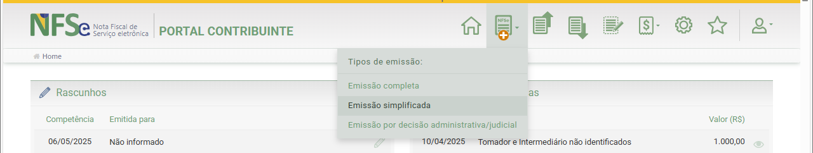
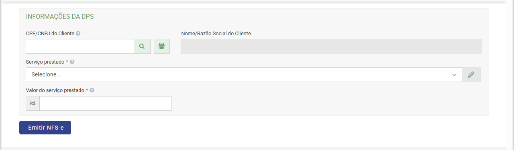
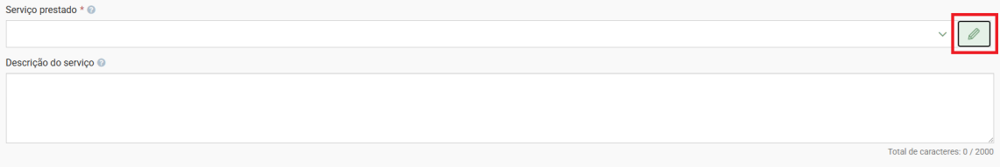
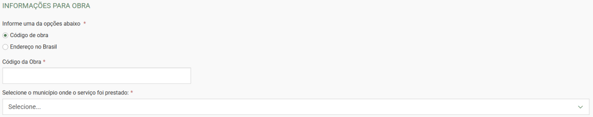
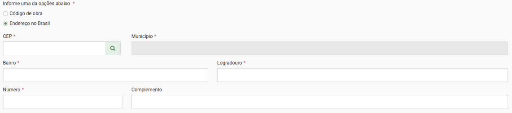
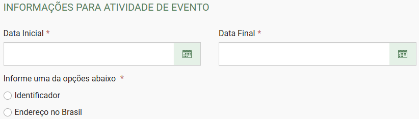
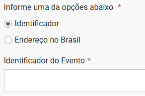
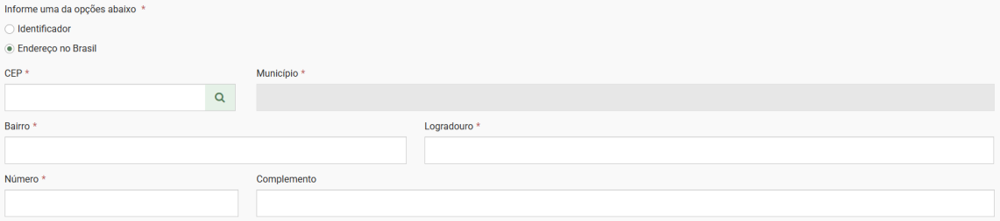

# 4.2.4 Emitir NFS-e

Após as configurações feitas acima, para os serviços cadastrados como “favoritos”, é possível a Emissão Simplificada da NFS-e.

*Figura 4.2.4-1 – Menu de tipos de emissão com a opção “Emissão simplificada”.*

Será apresentado um formulário simplificado para preenchimento de três informações: Identificador do cliente (o tomador/adquirente do serviço), Serviço prestado (o Código de Tributação Nacional do serviço, mas que será apresentado na lista conforme apelido dos “Serviços Favoritos” previamente cadastrados) e Valor do serviço prestado.

*Figura 4.2.4-2 – Formulário simplificado de emissão, com as informações da DPS.*

Para quase todos os serviços prestados, estes campos serão suficientes para a emissão simplificada para contribuintes MEI.

Caso o serviço prestado seja uma obra ou atividade de evento, o sistema solicitará informações adicionais de preenchimento que identificarão a obra ou seu local de execução para obras; e datas inicial/final e o identificador ou seu local de execução no caso de atividade de evento.

<!-- p.91 -->

| Campo | Descrição | Tipo | Ocorrência | Ação |
|---|---|---|---|---|
| CPF/CNPJ do Cliente | Informação sobre o CPF/CNPJ do tomador/adquirente | Numérico | Obrigatório | Incluir o CPF/CNPJ do tomador/adquirente. Pode-se recuperar os dados dos últimos tomadores/adquirentes clicando no ícone correspondente |
| Nome/Razão Social do Cliente | Informação sobre o Nome/Razão Social do Cliente | Texto | Obrigatório | Preenchimento automático pelo sistema com busca no cadastro CPF/CNPJ |
| Serviço Prestado | Informação sobre o serviço prestado. A lista exibe os serviços favoritos previamente cadastrados. Obs: caso deseje-se adicionar algum serviço à lista, basta cadastrar “novo serviço” na funcionalidade de “Serviços Favoritos”, item 4.2.3. acima. | Combo | Obrigatório | Selecionar um serviço prestado da lista |
| Descrição do Serviço | Campo acionado se clicar no editar (canto direito) do campo “Serviço Prestado”. O texto informado neste campo será utilizado somente na emissão da NFS-e ou para complementar o texto salvo na descrição do serviço cadastrado como “Serviço Favorito” que está sendo emitida. Não altera o texto cadastrado no “Serviço Favorito”. | Texto | Opcional | Editar ou complementar o texto salvo na descrição do serviço |
| Valor do serviço prestado | Informação sobre o valor total cobrado pelo serviço prestado, em moeda nacional. | Valor | Obrigatório | Incluir valor total do serviço, em reais. |

*Figura 4.2.4-3 – Campo “Serviço prestado” com o botão de edição da descrição.*

<!-- p.92 -->

## Serviço – Informações para Obra (Subitens 7.02 e 7.05)

Quando a emissão da NFS-e refere-se a serviço de obra, alguns campos adicionais devem ser informados.

O primeiro deles é marcar a opção se vai ser informado o Código de obra ou Endereço no Brasil. Conforme a opção marcada, o sistema exibirá campos diferentes a serem preenchidos.

### Opção: Código de Obra

| Campo | Descrição | Tipo | Ocorrência | Ação |
|---|---|---|---|---|
| Código da Obra | Informação sobre o número de identificação da obra | Texto | Obrigatório | Incluir o código da obra |
| Município | Informação do nome do município ao qual pertence a obra no Brasil | Texto | Obrigatório | Selecionar um dos municípios disponibilizados na lista |

*Figura 4.2.4-4 – Informações para obra, com a opção “Código de obra”.*

<!-- p.93 -->

### Opção: Endereço no Brasil

| Campo | Descrição | Tipo | Ocorrência | Ação |
|---|---|---|---|---|
| CEP | Informação do Código de endereçamento postal no Brasil | Numérico | Obrigatório | Informar o CEP do local da obra. |
| Município | Informação do nome do município ao qual pertence a obra no Brasil | Texto | Obrigatório | Recupera as informações de município na tabela TOM com o CEP informado |
| Bairro | Informação do nome do bairro | Texto | Obrigatório | Recupera as informações de logradouro na tabela TOM com o CEP informado |
| Logradouro | Informação do nome do logradouro | Texto | Obrigatório | Recupera as informações de logradouro na tabela TOM com o CEP informado |
| Número | Informação do número do logradouro | Texto | Obrigatório | Incluir o número do logradouro |
| Complemento | Informação do complemento do logradouro | Texto | Opcional | Incluir o complemento do logradouro |

*Figura 4.2.4-5 – Informações para obra, com a opção “Endereço no Brasil”.*

<!-- p.94 -->

## Serviço – Informações para Atividades de Eventos (subitens do item 12 – Serviços de diversões, lazer, entretenimento e congêneres)

Quando o serviço favorito cadastrado é um serviço constante dos subitens do item 12 do código de tributação nacional, serão exibidos alguns campos sobre o endereço do evento.

| Campo | Descrição | Tipo | Ocorrência | Ação |
|---|---|---|---|---|
| Data Inicial | Data em que se iniciou a prestação do serviço | Data | Obrigatório | Incluir a data de início do serviço |
| Data Final | Data em que se foi ou será concluída a prestação do serviço | Data | Obrigatório | Incluir a data final do serviço |

*Figura 4.2.4-6 – Informações para atividade de evento, com datas inicial e final e as opções de local.*

### Opção: Identificador

| Campo | Descrição | Tipo | Ocorrência | Ação |
|---|---|---|---|---|
| Identificador do Evento | Código identificador da atividade do evento determinado pela Administração Tributária Municipal | Código | Opcional | Incluir código de identificação da atividade do evento |
| Município | Informação do nome do município no qual a atividade de evento ocorreu | Texto | Obrigatório | Selecionar um dos municípios disponibilizados na lista |

*Figura 4.2.4-7 – Informações para atividade de evento, com a opção “Identificador”.*

<!-- p.95 -->

### Opção: Endereço no Brasil

| Campo | Descrição | Tipo | Ocorrência | Ação |
|---|---|---|---|---|
| CEP | Informação do Código de endereçamento postal no Brasil | Numérico | Obrigatório | Informar o CEP do local do evento |
| Município | Informação do nome do município ao qual pertence a atividade de evento no Brasil | Texto | Obrigatório | Recupera as informações de município na tabela TOM com o CEP informado |
| Bairro | Informação do nome do bairro | Texto | Obrigatório | Recupera as informações de logradouro na tabela TOM com o CEP informado |
| Logradouro | Informação do nome do logradouro | Texto | Obrigatório | Recupera as informações de logradouro na tabela TOM com o CEP informado |
| Número | Informação do número do logradouro | Texto | Obrigatório | Incluir o número do logradouro |
| Complemento | Informação do complemento do logradouro | Texto | Opcional | Incluir o complemento do logradouro |

*Figura 4.2.4-8 – Informações para atividade de evento, com a opção “Endereço no Brasil”.*

Após o preenchimento dos dados obrigatórios, conforme o serviço prestado, deve-se clicar no ícone *[ícone não reproduzido no texto da fonte]*.
