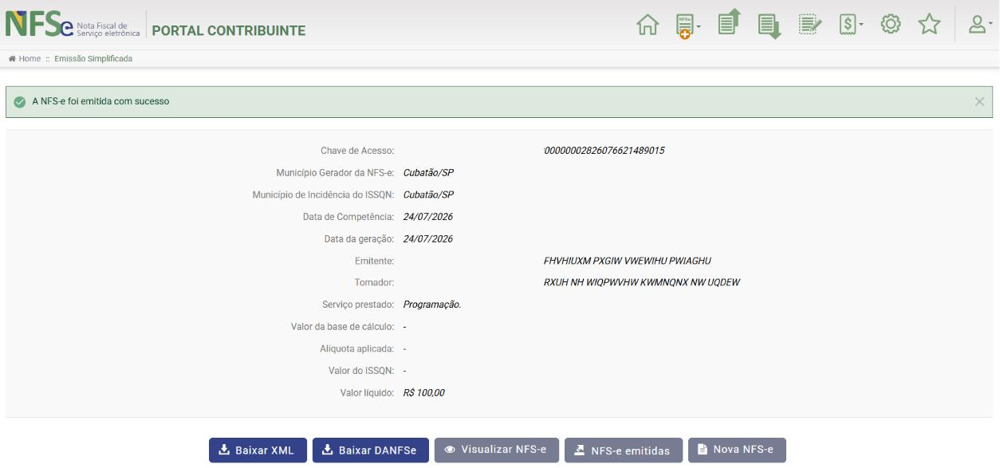

<!-- p.96 -->

# 4.2.5 NFS-e Gerada com sucesso

Será apresentado um resumo da NFS-e gerada, incluindo a chave de acesso à mesma.

*Figura 4.2.5-1 – Resumo da NFS-e emitida com sucesso no fluxo de emissão simplificada.*

Após a NFS-e gerada com sucesso o Emissor Web permite ações:

- Baixar o XML da NFS-e;
- Baixar o DANFSe (Documento Auxiliar de Nota Fiscal de Serviço eletrônica – representação gráfica da NFS-e com informações resumidas da nota) em formato PDF;
- Visualizar NFS-e (visualização no navegador do emitente em formato web);
- NFS-e emitidas (direciona para a funcionalidade que exibe as NFS-e emitidas pelo usuário);
- Nova NFS-e (recomeça o preenchimento da DPS para a geração de uma nova NFS-e).
