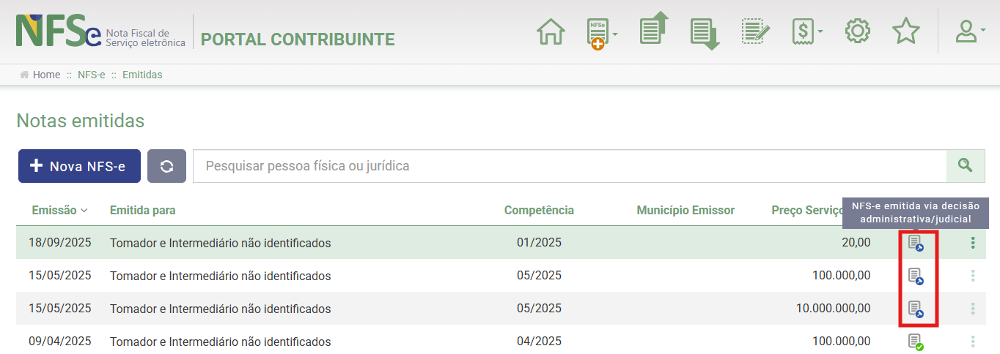

<!-- p.98 -->

# 4.3.2 Consulta de NFS-e emitida por decisão administrativa/judicial

Para identificar as NFS-e emitidas pelo fluxo de decisão administrativa/judicial, basta acessar a opção “NFS-e Emitidas” no menu principal e localizar as notas emitidas que possuem a identificação abaixo (ícone com detalhe azul – ):

*Figura 4.3.2-1 – Lista de NFS-e emitidas com o ícone de NFS-e emitida via decisão administrativa/judicial.*
