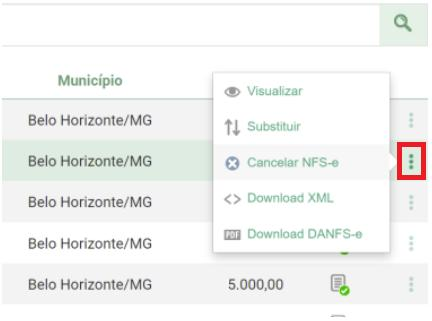
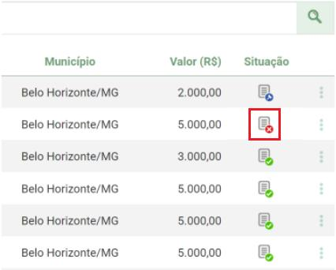

# 4.3.3 Cancelar NFS-e emitidas por decisão administrativa/judicial

Para cancelar uma nota emitida pelo fluxo de decisão administrativa/judicial, deve-se acessar a opção “NFS-e Emitidas” no menu principal e identificar a nota que deseja cancelar.

<!-- p.99 -->

No menu lateral da nota desejada, selecionar a opção “Cancelar NFS-e” conforme a tela abaixo:

*Figura 4.3.3-1 – Menu da NFS-e com a opção “Cancelar NFS-e” destacada.*

Preencher as informações da janela aberta e clicar em “Cancelar NFS-e”. A nota cancelada terá seu status alterado conforme a tela abaixo:

*Figura 4.3.3-2 – Situação da NFS-e cancelada na listagem de NFS-e emitidas.*
