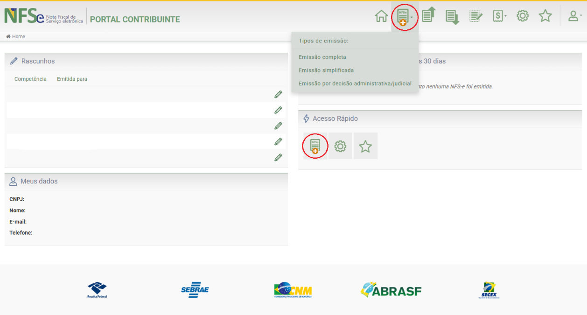

# 4 Emitindo a Nota Fiscal

Para emitir a nota fiscal pelo Emissor Web, deve-se selecionar o ícone do menu marcado com o sinal de + na imagem abaixo e selecionar se deseja utilizar a Emissão Completa, Emissão Simplificada e Emissão por Decisão Administrativa/Judicial; ou, selecionar o mesmo ícone no painel de acesso rápido, que direcionará para a Emissão Completa. A Emissão Simplificada é disponível apenas para o MEI.

<!-- p.20 -->

*Menu de tipos de emissão: ícone marcado com o sinal de +.*
