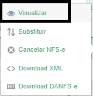

<!-- p.101 -->

# 5.1 Visualizar NFS-e e Eventos Vinculados

Permite visualizar as informações da NFS-e, além da opção de download da mesma nos formatos HTML (Transformação do XML com XSLT), XML e PDF. A visualização retorna, além das informações da NFS-e, também dos eventos vinculados à NFS-e. Estes últimos, estão disponíveis somente no formato HTML (Transformação do XML com XSLT).

*Figura 5.1-1 – Menu da NFS-e com a ação “Visualizar” destacada.*
