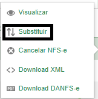
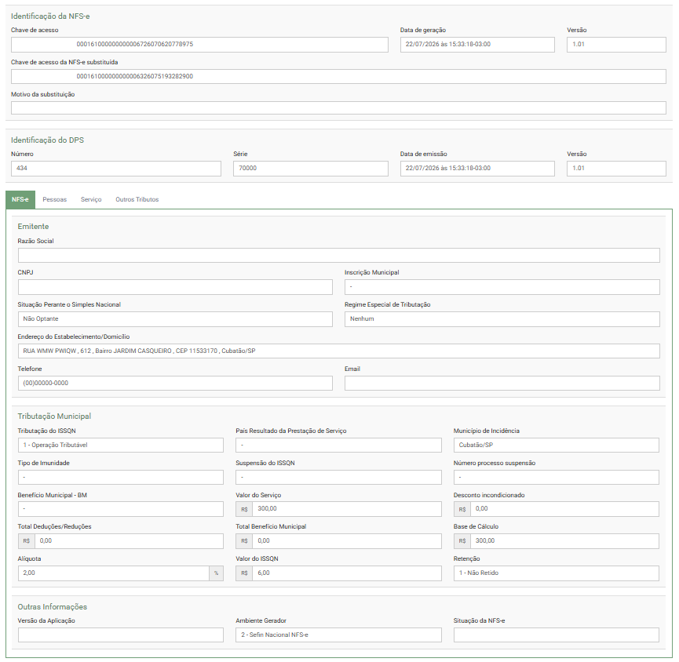
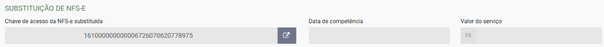
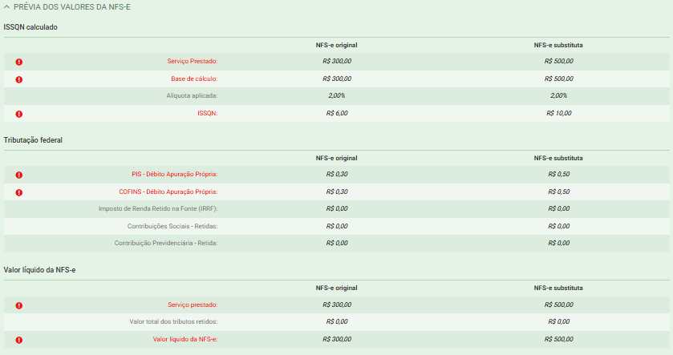

<!-- p.102 -->

# 5.2 Substituição de NFS-e

O processo de substituição de uma NFS-e é o processo de emissão de uma DPS com alteração de uma ou mais informações de uma DPS já emitida com NFS-e gerada, com a informação da chave de acesso da NFS-e existente na nova DPS, para que o sistema entenda que este envio de DPS se trata de uma substituição de NFS-e e realize todas as validações necessárias para realizar a substituição da NFS-e original pela NFS-e substituta.

Este processo realiza o cancelamento da NFS-e original através da geração e vinculação de um Evento de Cancelamento por Substituição de NFS-e. O cancelamento por substituição de uma NFS-e segue as regras de validação para cancelamento de NFS-e conforme ANEXO_I-SEFIN_ADN-DPS_NFSe-SNNFSe.

Todos estes documentos fiscais eletrônicos ficam vinculados mantendo a rastreabilidade entre eles. O processo de substituição pelo Emissor Web é realizado prestando as mesmas informações da emissão da DPS.

*Figura 5.2-1 – Ação “Substituir” destacada no menu da NFS-e.*

*Figura 5.2-2 – Dados de substituição: chave de acesso da NFS-e substituída e identificação da DPS.*

*Figura 5.2-3 – Campos de substituição: chave de acesso da NFS-e substituída, data de competência e valor do serviço.*

Ao final é exibido um comparativo entre as informações da NFS-e original e da NFS-e substituta, por exemplo:

*Figura 5.2-4 – Prévia dos valores da NFS-e original e da NFS-e substituta.*

Os parâmetros para a substituição de uma NFS-e são cadastradas pelo município vinculado à emissão da NFS-e. Cada município define os seguintes parâmetros, e as dúvidas em relação a eles devem ser encaminhadas ao próprio município:

- Se existe um prazo máximo para a substituição de uma NFS-e;
- Qual é o prazo máximo (em dias) para substituição de uma NFS-e;
- Se é permitido substituir uma NFS-e onde os não-emitentes não foram identificados;
- Se é permitido alterar as informações dos não-emitentes na NFS-e substituta.
