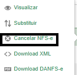
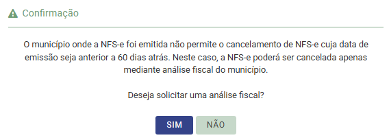
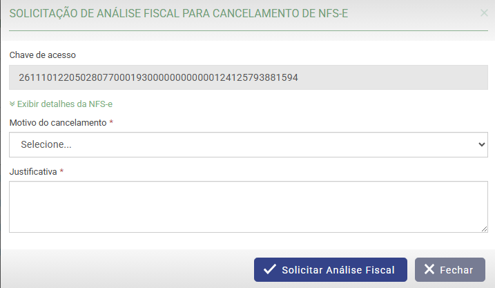

<!-- p.103 -->

# 5.3 Cancelamento de NFS-e e Solicitação de Cancelamento por Análise Fiscal

O processo de cancelamento de uma NFS-e realiza o cancelamento da NFS-e original através da geração e vinculação de um Evento de Cancelamento de NFS-e. O cancelamento de uma NFS-e segue as regras de validação para cancelamento de NFS-e dispostas no ANEXO_I-SEFIN_ADN-DPS_NFSe-SNNFSe.

Todos estes documentos fiscais eletrônicos ficam vinculados, mantendo a rastreabilidade entre eles.

O processo de cancelamento pelo Emissor Web é realizado prestando as informações permitidas conforme campos abaixo. Este evento gera um arquivo XML, conforme leiautes dos eventos definidos no Anexo II, que é processado conforme regras de validação para ser armazenado em banco de dados e vinculado à NFS-e.

*Figura 5.3-1 – Ação “Cancelar NFS-e” destacada no menu da NFS-e.*

<!-- p.104 -->

| Campo | Descrição | Tipo | Ocorrência | Ação |
|---|---|---|---|---|
| Chave de acesso | Informação da chave de acesso que identifica a NFS-e | Texto | Obrigatório | Recuperado pelo sistema |
| **Detalhes da NFS-e** | | | | |
| Número da DPS | Informação sobre o número da DPS | Numérico | Conforme Regra de Negócio | Recuperado pelo sistema |
| Série da DPS | Informação da série da DPS | Numérico | Conforme Regra de Negócio | Recuperado pelo sistema |
| Número da NFS-e | Informação sobre o Número da NFS-e | Numérico | Conforme Regra de Negócio | Recuperado pelo sistema |
| Data da Geração | Informação da data da geração da NFS-e | Data | Obrigatório | Recuperado pelo sistema |
| Valor do serviço | Informação sobre o valor total cobrado pelo serviço prestado | Valor | Obrigatório | Recuperado pelo sistema |
| Município Gerador | Informação sobre o município que gerou a NFS-e | Texto | Obrigatório | Recuperado pelo sistema |
| Emitido para | Informação sobre para quem a NFS-e foi emitida | Texto | Obrigatório | Recuperado pelo sistema |
| Serviço prestado | Informação do código/Descrição do Serviço | Texto | Obrigatório | Recuperado pelo sistema |
| Motivo Cancelamento | Descrição do motivo do cancelamento | Combo | Obrigatório | Incluir o motivo do cancelamento da NFS-e |
| Justificativa | Descrição da justificativa para o cancelamento | Texto | Obrigatório | Incluir a justificativa para o cancelamento |

<!-- p.105 -->

Caso o cancelamento de NFS-e não seja possível conforme as regras para cancelamento definidas pelo município vinculado à emissão da NFS-e, o sistema exibirá uma mensagem de alerta:

*Figura 5.3-2 – Alerta de cancelamento não permitido, com a opção de solicitar análise fiscal.*

Se a resposta for “SIM”, ele permite que esta ação para cancelamento se torne um evento de Solicitação para Cancelamento de NFS-e por Análise Fiscal.

Será exibida a tela abaixo, onde deverá ser selecionado o “Motivo do Cancelamento” e a “Justificativa”.

*Figura 5.3-3 – Solicitação de análise fiscal para cancelamento de NFS-e.*
