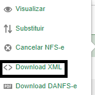

<!-- p.106 -->

# 5.4 Download XML

Para fazer o download do arquivo XML da NFS-e emitida, o emitente aciona o comando “Download XML” para manter uma cópia deste arquivo no seu ambiente computacional. O sistema baixará o modelo XML com os dados preenchidos da NFS-e.

*Figura 5.4-1 – Ação “Download XML” destacada no menu da NFS-e.*
