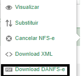
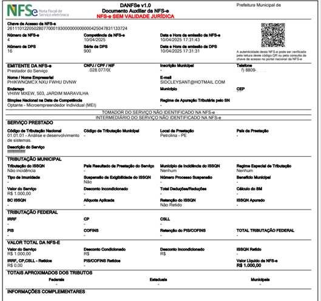

# 5.5 Download DANFSe

Para fazer o download do arquivo PDF do DANFSe da NFS-e emitida, o emitente aciona o comando “Download DANFS-e” para manter uma cópia deste arquivo no seu ambiente computacional. O sistema baixará o modelo XML com os dados preenchidos da NFS-e.

*Figura 5.5-1 – Ação “Download DANFS-e” destacada no menu da NFS-e.*

<!-- p.107 -->

*Figura 5.5-2 – Exemplo de DANFSe.*
