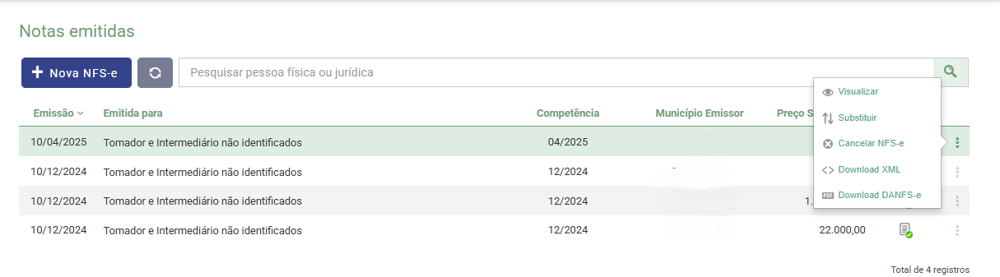

# 5 Consultas NFS-e Emitidas

Ao clicar no ícone “NFS-e emitidas”, o usuário consulta as NFS-e emitidas. Na tela serão exibidos alguns campos de cada uma das NFS-e (Emissão, Emitida para, Competência, Município Emissor, Preço Serviço (R$), Situação):

*Figura 5-1 – Ícone “NFS-e Emitidas” no menu superior.*

*Figura 5-2 – Lista de NFS-e emitidas, com as ações de cada linha.*

A partir da listagem das NFS-e emitidas o emitente pode filtrar as notas conforme filtros descritos no campo de pesquisa da aplicação. O sistema deve totalizar o quantitativo de registros que atendem aos critérios de buscas (Total NFS-e emitidas) e exibir na tela o campo totalizador das NFS-e emitidas, desde o início de utilização do sistema até a data presente de visualização da consulta pelo emitente. Para atender aos requisitos de performance e usabilidade do sistema o resultado da consulta é retornado por páginas na tela.

Outras ações podem ser realizadas para cada uma das notas listadas, acessando em cada uma das linhas:

- Visualizar NFS-e (visualização no navegador do emitente em formato web);
- Substituir NFS-e (recarrega as informações da DPS da NFS-e para que o emitente possa alterar informações de alguns campos possíveis e reenviar a DPS para gerar uma NFS-e substituta à NFS-e original);
- Cancelar NFS-e (realiza a ação para o cancelamento da NFS-e selecionada);
- Download do XML da NFS-e (baixa o arquivo XML da NFS-e);
- Download do DANFSe (Documento Auxiliar de Nota Fiscal de Serviço eletrônica – representação gráfica da NFS-e com informações resumidas da nota) em formato PDF.

Se o usuário clicar em “Nova NFS-e”, iniciará o preenchimento da DPS para a geração de uma nova NFS-e.
