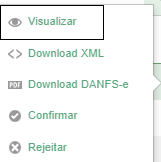

<!-- p.108 -->

# 6.1 Visualizar NFS-e recebida

Apresentará a NFS-e emitida por outro usuário para o CPF/CNPJ do usuário emitente logado.

*Figura 6.1-1 – Ação “Visualizar” destacada no menu da NFS-e recebida.*
