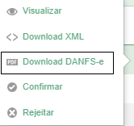

<!-- p.109 -->

# 6.3 Download DANFSe

Para fazer o download do arquivo PDF do DANFSe da NFS-e emitida, o emitente aciona o comando “Download DANFS-e” para manter uma cópia deste arquivo no seu ambiente computacional. O sistema fará download de um PDF com o DANFSe da NFS-e emitida para o usuário logado.

*Figura 6.3-1 – Ação “Download DANFS-e” destacada no menu da NFS-e recebida.*
