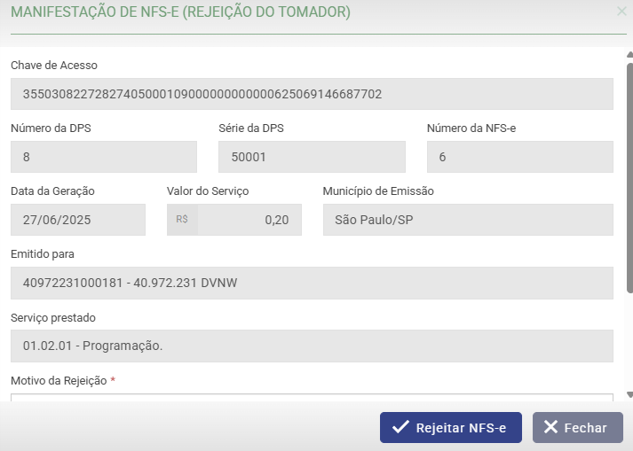
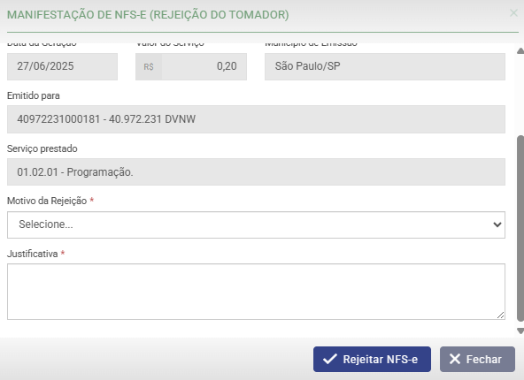

# 6.4.2 Rejeitar uma NFS-e

Ao consultar a área de Notas Recebidas, o usuário poderá acionar o comando “Rejeitar” do menu disponibilizado caso reconheça a NFS-e emitida para ele como tomador/adquirente de serviço de um outro emitente. Esta ação gera um arquivo XML (evento de manifestação), conforme leiaute definido no ANEXO_I-SEFIN_ADN-DPS_NFSe-SNNFSe, que será processado, armazenado e vinculado à NFS-e correspondente.

Ao clicar em “Rejeitar”, o sistema exibirá uma tela com um resumo da NFS-e emitida, conforme modelo abaixo:

<!-- p.111 -->

*Figura 6.4.2-1 – Manifestação de NFS-e (rejeição do tomador), com o resumo da NFS-e.*

Deve-se selecionar no campo “Motivo da Rejeição” uma das opções:

- NFS-e em duplicidade;
- NFS-e emitida pelo tomador;
- Não ocorrência do fato gerador;
- Erro quanto à responsabilidade tributária;
- Erro quanto ao valor do serviço, valor das deduções ou serviço prestado ou data do fato gerador;
- Outros.

Deve-se preencher também o campo da “Justificativa”.

*Figura 6.4.2-2 – Campos “Motivo da Rejeição” e “Justificativa” da manifestação de rejeição.*

Após o preenchimento deve-se clicar no botão “Rejeitar NFS-e”.
