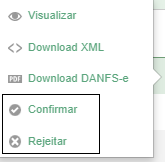

# 6.4 Manifestação de NFS-e

O emitente da NFS-e logado no sistema poderá manifestar-se a respeito de uma NFS-e que foi emitida com sua identificação como tomador/adquirente de um serviço de uma NFS-e.

O Evento de Manifestação de NFS-e pode ser de Confirmação (onde o não emitente aceita e concorda com as informações registradas na nota) ou de Rejeição (onde o não emitente não aceita nem concorda com as informações registradas na nota).

Cada um dos não emitentes indicados na NFS-e pode manifestar-se em relação a uma nota. Portanto, estão previstos eventos de Confirmação e Rejeição de NFS-e emitidos cada um pelo Prestador/Fornecedor, Tomador/Adquirente ou Intermediário, a depender de quem seja o emitente da NFS-e.

Assim, toda nota recebida por um usuário estará na área de Notas Recebidas do sistema e se poderá acionar os comandos para confirmar ou rejeitar aquela NFS-e. Esta ação gera um arquivo XML, conforme leiaute definido no ANEXO_I-SEFIN_ADN-DPS_NFSe-SNNFSe e, que será processado, armazenado e vinculado à NFS-e correspondente.

*Figura 6.4-1 – Ações “Confirmar” e “Rejeitar” destacadas no menu da NFS-e recebida.*
