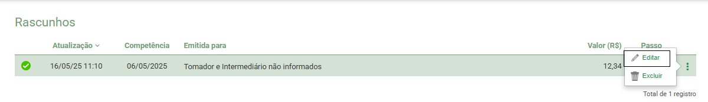

<!-- p.113 -->

# 7.1 Editar DPS

A partir do registro do rascunho listado, o emitente pode continuar a edição da DPS acionando o comando “Editar”. O sistema irá retomar o preenchimento da DPS do passo em que o rascunho está, p. ex.: serviço.

A edição de uma DPS permite a alteração de todos os campos da DPS seguindo os mesmos passos para a emissão de NFS-e demonstradas neste documento de regras de negócio.

*Figura 7.1-1 – Lista de rascunhos com a ação “Editar” destacada.*
