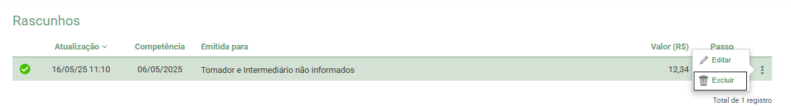

# 7.2 Excluir DPS

A partir do registro do rascunho listado, o emitente pode deletar fisicamente o rascunho acionando o comando “Excluir”.

*Figura 7.2-1 – Lista de rascunhos com a ação “Excluir” destacada.*
