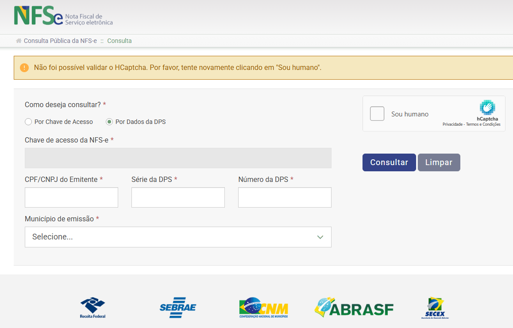

<!-- p.117 -->

# 9.2 Consulta informando os dados da DPS

A Declaração de Prestação de Serviço (DPS) é um documento de posse e responsabilidade do contribuinte, que deverá ser gerado manualmente ou por alguma aplicação adquirida, possuindo uma numeração sequencial crescente e devendo ser convertido em NFS-e no prazo estipulado pela legislação tributária municipal.

Neste caso deve-se, obrigatoriamente, preencher os seguintes dados:

- CPF/CNPJ do Emitente;
- Série da DPS (a série da DPS na NFS-e nacional é um código sequencial utilizado para identificar a ordem de emissão das DPS, que são documentos preparatórios para a emissão da Nota Fiscal de Serviço eletrônica. A série pode ser numérica ou alfabética, dependendo da prefeitura ou do sistema utilizado. A série da DPS pode ser encontrada no próprio documento eletrônico ou PDF da NFS-e, geralmente em um campo específico com a nomenclatura “Série da DPS” ou similar. No arquivo XML da NFS-e, as informações da série também podem ser encontradas nas tags correspondentes.);
- Número da DPS;
- Município de emissão (selecionar dentre aqueles disponíveis na lista).

*Figura 9.2-1 – Tela de consulta pública por dados da DPS, com mensagem de validação do hCaptcha.*

<!-- p.118 -->

Após o preenchimento dos campos obrigatórios, preencher o hCaptcha e clicar em “Consultar”.
