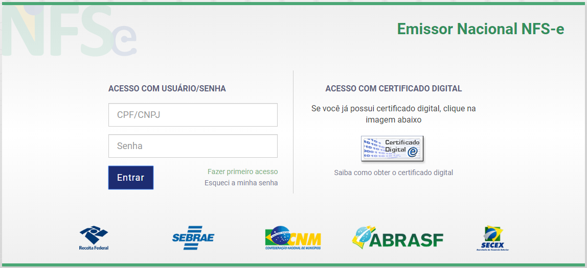

# 10.6.1 Controle de Acesso por Usuário/Senha

O acesso pelo usuário CNPJ ou CPF e pela senha gerada no Sistema Nacional da NFS-e disponibiliza as funcionalidades conforme definição dos níveis de acesso para o tipo de acesso realizado do Sistema Nacional da NFS-e, sem a necessidade de certificado digital.

*Figura 10.6.1-1 – Tela de acesso ao Emissor Nacional NFS-e, por usuário/senha ou certificado digital.*

Se o emitente estiver apenas cadastrado, mas não estiver habilitado, ou seja, estiver bloqueado para emissão, o sistema permitirá acesso à funcionalidade para emissão de NFS-e, mas indicará por mensagem ao emitente a sua situação de bloqueio no CNC.

Ao final, o controle de acesso por usuário/senha realizado é registrado na tabela de log do sistema.
