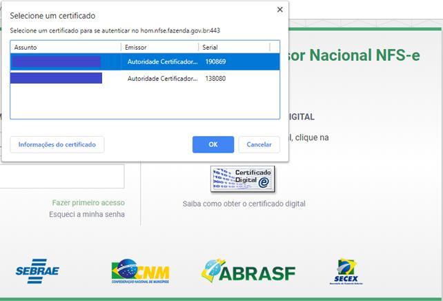

# 10.6.2 Controle de Acesso por Certificado Digital

O acesso por certificado digital disponibiliza as funcionalidades de consultas e emissão de NFS-e do Sistema Nacional da NFS-e.

*Figura 10.6.2-1 – Seleção de certificado digital para autenticação no Emissor Nacional NFS-e.*

<!-- p.124 -->

Ao final, o controle de acesso por certificado digital realizado é registrado na tabela de log do sistema.
