<!-- p.07 -->

# 1.1.1 Acesso com Usuário/Senha

Para realizar este acesso, é necessário, incialmente, fazer um cadastro para o emissor (CPF ou CNPJ). Para isto deve-se clicar em: “Fazer primeiro acesso”.

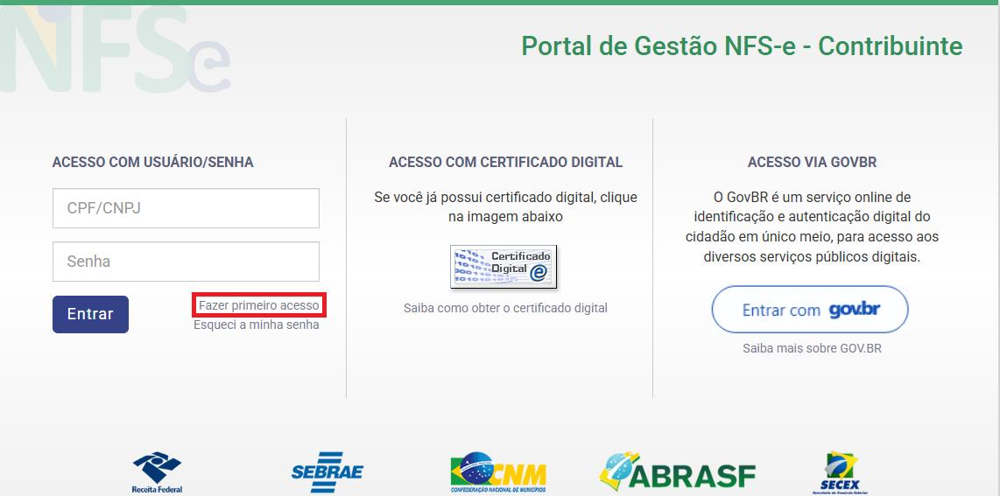

*Figura 2 – Tela de acesso com o link “Fazer primeiro acesso” destacado.*

Na próxima tela serão solicitadas as informações conforme o tipo de contribuinte: Pessoa Física ou Jurídica.

<!-- p.08 -->

## a) Pessoa Física

Marcar a opção “CPF”. O sistema abrirá os campos: “CPF” e “Data de nascimento”. Preencher os dois campos e clicar em “Avançar”.

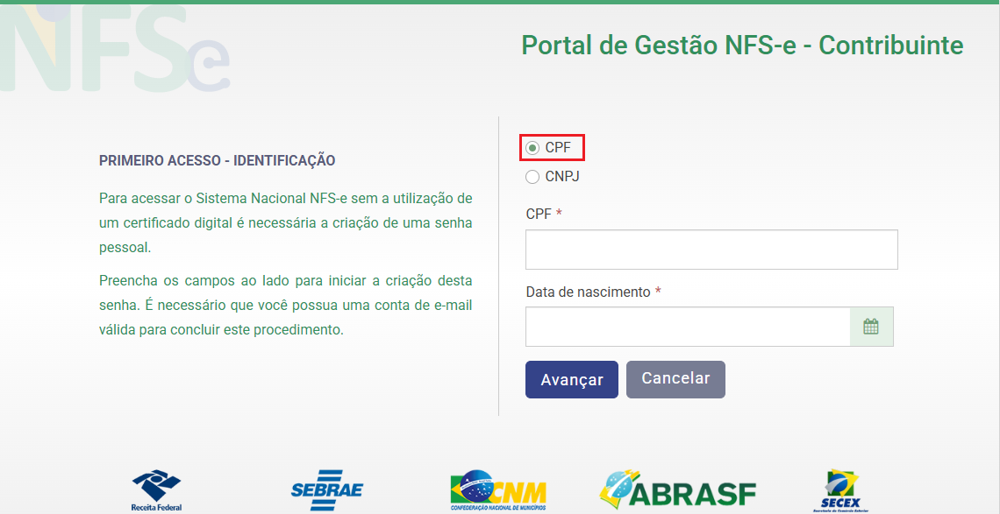

*Figura 3 – Primeiro acesso, identificação do contribuinte Pessoa Física.*

| Erro | Mensagem |
|------|----------|
| CPF não existente | “Não foi possível recuperar informações do Contribuinte.” |
| CPF informado para o emitente da NFS-e é inválido (verificar DV). | “Informe um CPF válido” |
| A data de nascimento diferente da informada no cadastro CPF. | “A data de nascimento informada não corresponde ao CPF informado.” |

<!-- p.09 -->

A tela seguinte solicitará o número do título de eleitor para o CPF informado. Preencher o campo e clicar em “Avançar”.

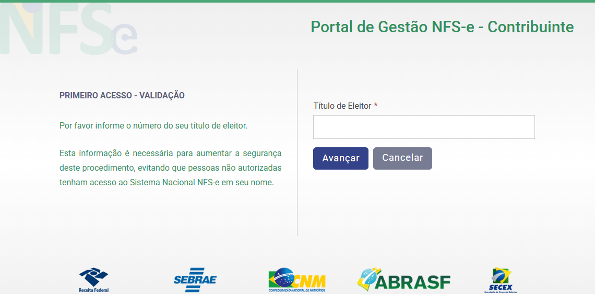

*Figura 4 – Primeiro acesso, validação com o título de eleitor.*

Caso o emissor tenha declarado imposto de renda pessoa física, será necessário informar os números dos recibos das declarações de renda dos dois últimos anos, se for o caso. Preencher os campos e clicar em “Avançar”.

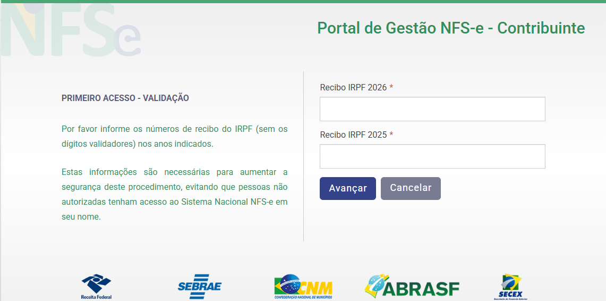

*Figura 5 – Primeiro acesso, informação dos recibos de IRPF.*

Na próxima tela, deverá ser informado um e-mail e criada uma senha de acesso. Preencher todos os campos e clicar em “Avançar”.

<!-- p.10 -->

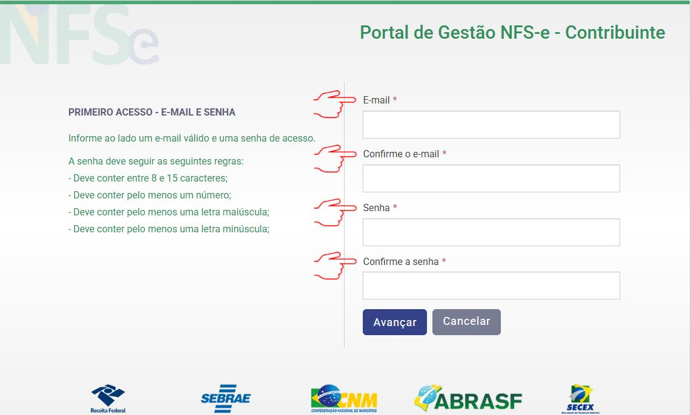

*Figura 6 – Primeiro acesso, cadastro de e-mail e senha.*

Será enviado um “código de segurança” no e-mail cadastrado. Deve-se acessar o e-mail e verificar o “código de segurança” enviado. Informar o código no campo correspondente e clicar em “Avançar”.

A etapa para o primeiro acesso de Pessoa Física está finalizada.

## b) Pessoa Jurídica

Marcar a opção “CNPJ”. O sistema abrirá os campos: “CNPJ”, “CPF do responsável” e “Data de nascimento” (do responsável). Preencher os três campos e clicar em “Avançar”.

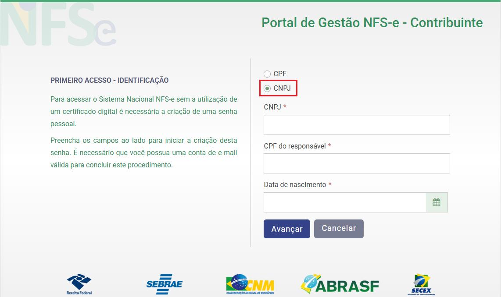

*Figura 7 – Primeiro acesso, identificação do contribuinte Pessoa Jurídica.*

<!-- p.11 -->

| Erro | Mensagem |
|------|----------|
| CNPJ não existente | “Não foi possível recuperar informações do Contribuinte.” |
| CPF do responsável diferente do informado no Cadastro CNPJ | “O CPF informado não corresponde ao CPF responsável pelo CNPJ informado.” |
| A data de nascimento do responsável é diferente da cadastrada no cadastro CPF | “A data de nascimento informada não corresponde ao CPF informado.” |

A tela seguinte solicitará o número do título de eleitor do responsável pelo CNPJ informado. Preencher o campo e clicar em “Avançar”.

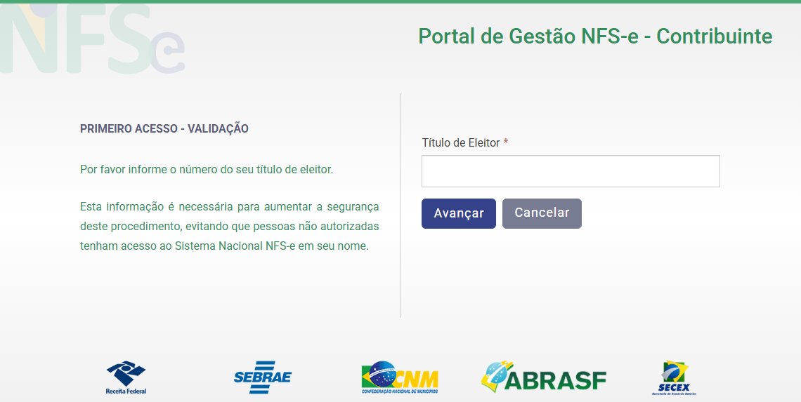

*Figura 8 – Primeiro acesso de Pessoa Jurídica, título de eleitor do responsável pelo CNPJ.*

<!-- p.12 -->

Caso o responsável pelo CNPJ tenha declarado imposto de renda pessoa física, será necessário informar os números dos recibos das declarações de renda dos dois últimos anos, se for o caso. Preencher os campos e clicar em “Avançar”.

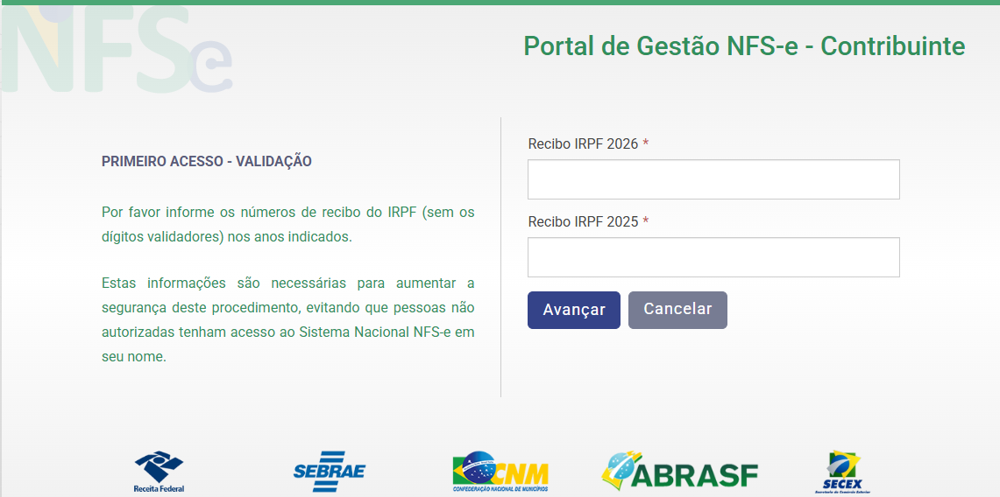

*Figura 9 – Primeiro acesso de Pessoa Jurídica, recibos de IRPF do responsável.*

Na próxima tela, deverá ser informado um e-mail e criada uma senha de acesso. Preencher todos os campos e clicar em “Avançar”.

<!-- p.13 -->

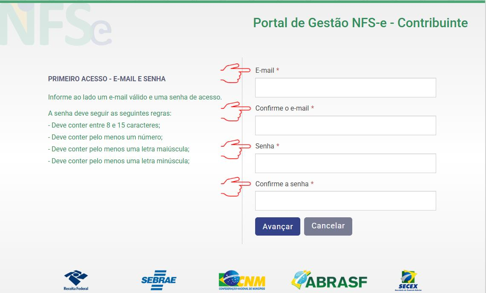

*Figura 10 – Primeiro acesso de Pessoa Jurídica, cadastro de e-mail e senha.*

Será enviado um “código de segurança” no e-mail cadastrado. Deve-se acessar o e-mail e verificar o “código de segurança” enviado. Informar o código no campo correspondente e clicar em “Avançar”.

A etapa para o primeiro acesso de Pessoa Jurídica está finalizada.

Em ambos os casos, ao finalizar o cadastro de Usuário/Senha, será exibida a página inicial do Portal onde deve ser informado o usuário (CPF/CNPJ) e a senha previamente cadastrados. Preencher ambos os campos e clicar em “Entrar”.

<!-- p.14 -->

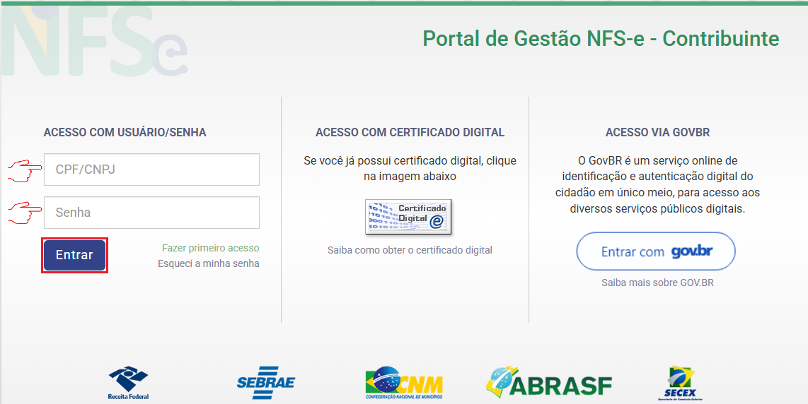

*Figura 11 – Página inicial do Portal com os campos de usuário e senha.*

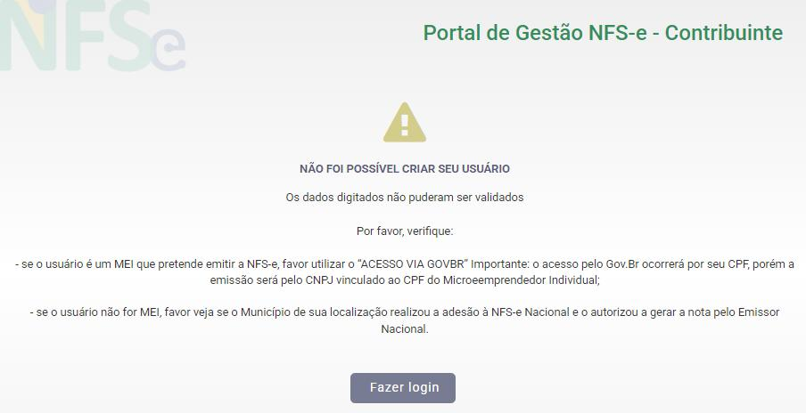

*Figura 12 – Mensagem de erro exibida na tela de criação do usuário.*

1) Não foi possível criar seu usuário
