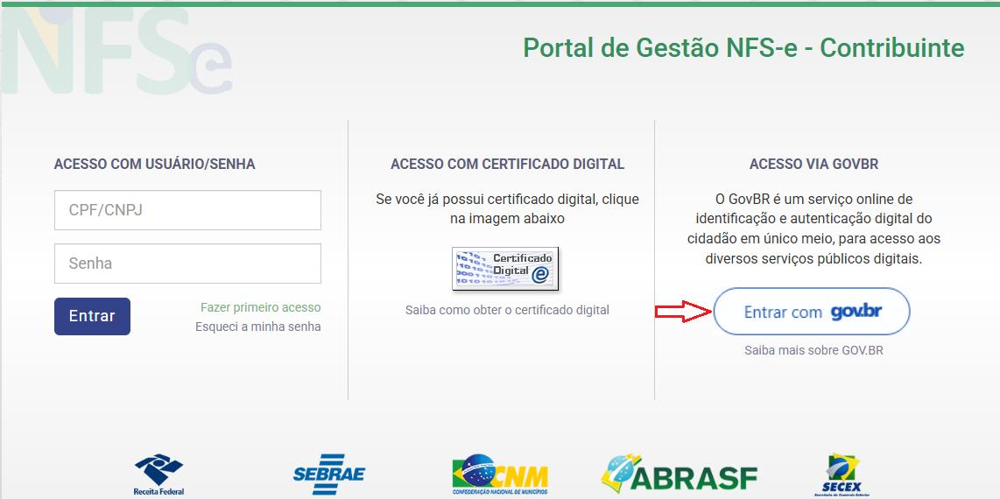
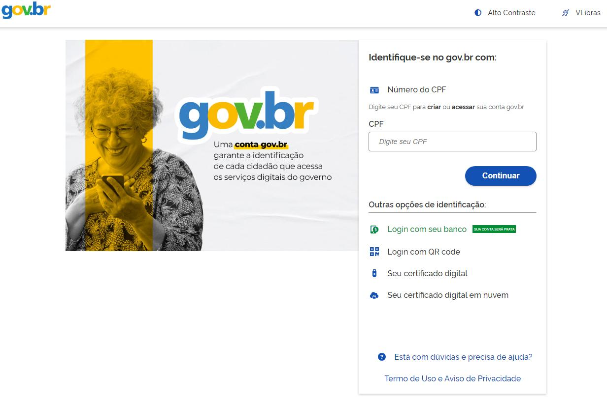

<!-- p.16 -->

# 1.1.3 Acesso com GOV.BR

Uma terceira forma de acesso é com o uso do serviço GOV.BR. Clicar sobre o ícone “Entrar com gov.br” e o sistema abrirá a janela de login do GOV.BR. Realizar o login, conforme as orientações do site.

*Figura 16 – Tela de acesso, botão “Entrar com gov.br” (indicado pela seta).*

*Figura 17 – Janela de identificação do GOV.BR.*

Três observações importantes em relação ao acesso a partir dessa integração:

1. Apenas as contas com selo de confiabilidade Prata ou Ouro do GOV.BR serão aceitas;
2. Nesse mecanismo, o usuário se logará com o seu CPF. Caso o usuário queira alternar o perfil para um CNPJ de sua responsabilidade ou representação, ele deve se utilizar do mecanismo de Alternância de Perfis descrito em tópico específico deste guia;
3. Para os Microempreendedores Individuais – MEI, há uma exceção em relação à observação “2)”.
