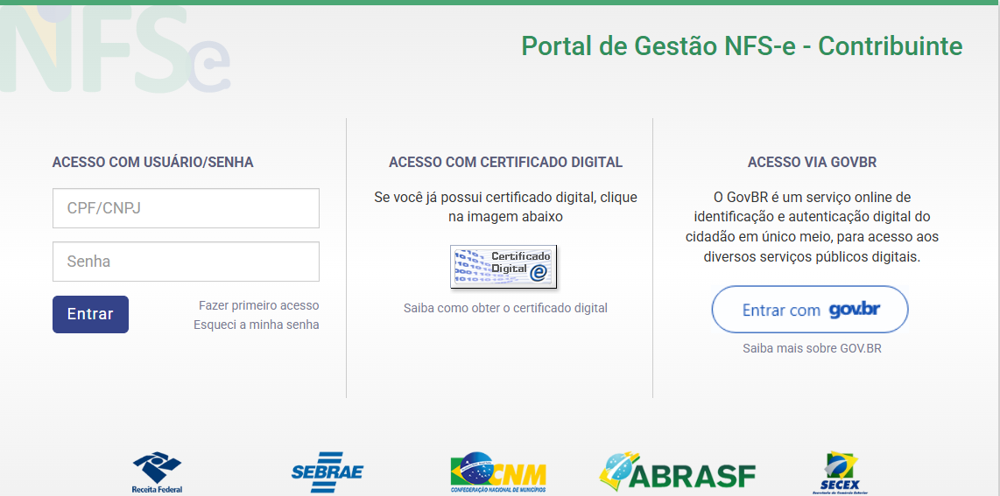

<!-- p.07 -->

# 1.1 Acesso ao Emissor Público Nacional da NFS-e

O contribuinte deverá acessar o Portal de Gestão NFS-e – Contribuinte.

O acesso ao Portal se dá de 3 formas:

a) Acesso com usuário e senha;
b) Acesso com certificado digital;
c) Acesso via GOV.BR.

*Figura 1 – Tela de acesso do Portal de Gestão NFS-e – Contribuinte, com as três formas de acesso (usuário/senha, certificado digital e GOV.BR).*

As subseções seguem em páginas próprias:

- [1.1.1 Acesso com Usuário/Senha](01-01-01-usuario-senha.md)
- [1.1.2 Acesso com Certificado Digital](01-01-02-certificado-digital.md)
- [1.1.3 Acesso com GOV.BR](01-01-03-gov-br.md)
