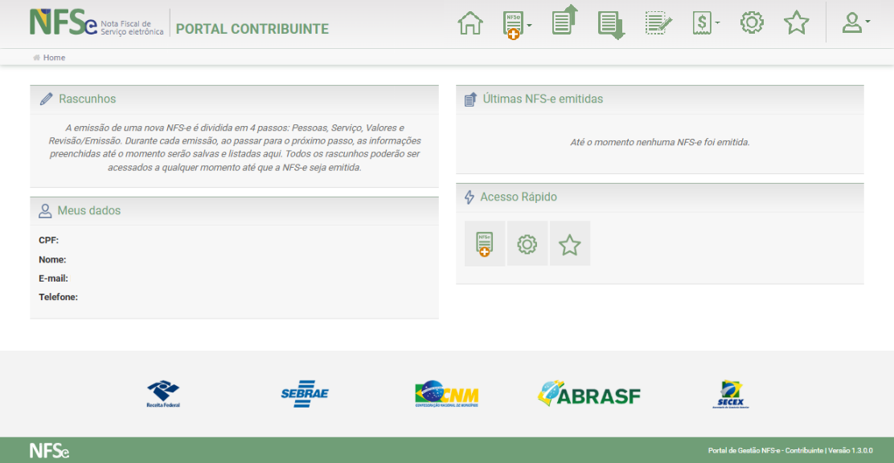

<!-- p.18 -->

# 2.1 Menu

*Figura 19 – Painel principal com o menu de módulos.*

- Página inicial;
- Tipos de emissão (completa, simplificada e por decisão administrativa/judicial);
- NFS-e emitidas;
- NFS-e recebidas;
- Rascunhos;
- Módulo de Apuração Nacional – MAN (por ora, apenas em ambiente de Prod. Restrita);
- Configurações;
- Serviços Favoritos;
