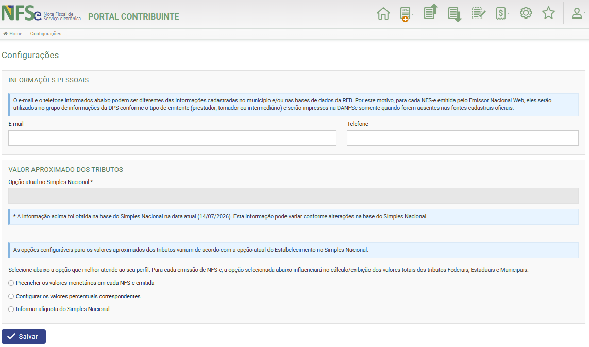

<!-- p.18 -->

# 3 Configurações

Este módulo deve ser o primeiro a ser acessado. Ele contempla as funcionalidades de complemento das informações do emitente da NFS-e.

<!-- p.19 -->

*Figura 20 – Tela de Configurações do Portal Contribuinte.*

O e-mail e o telefone informados podem ser diferentes das informações cadastradas no município e/ou nas bases de dados da RFB. Por este motivo, para cada NFS-e emitida pelo Emissor Nacional Web, eles serão utilizados no grupo de informações da DPS conforme o tipo de emitente (Prestador/Fornecedor, Tomador/Adquirente ou Intermediário) e serão impressos no DANFSe somente quando forem ausentes nas fontes cadastrais oficiais.

| Campo | Descrição | Tipo | Ocorrência | Ação |
|-------|-----------|------|------------|------|
| E-mail | Endereço de e-mail | Endereço de e-mail | Opcional | Informar um endereço de e-mail |
| Telefone | Telefone para contato | Número | Opcional | Incluir um telefone |
| Opção atual no Simples Nacional | Informação sobre a opção atual no Simples Nacional do emitente. | Texto | Obrigatório | Este campo é recuperado dos cadastros RFB. |

**Valor aproximado dos tributos** – marcar a opção que melhor atende ao perfil do emitente. Para cada emissão de NFS-e, a opção selecionada abaixo influenciará no cálculo/exibição dos valores totais dos tributos Federais, Estaduais e Municipais.

<!-- p.20 -->

- **Preencher os valores monetários em cada NFS-e emitida:** se esta for a opção marcada, nenhum preenchimento será necessário.
- **Configurar os valores percentuais correspondentes:** se esta for a opção marcada, deve-se preencher os percentuais “Federal”, “Estadual” e “Municipal”.
- **Informar alíquota do Simples Nacional:** a opção “Informar alíquota do Simples Nacional” será exibida somente para os optantes desse regime. Nesse caso, a ME/EPP informará a alíquota nominal a qual está sujeita nos termos do referido regime, conforme o art. 9º, do Decreto 8.264/2014, que regulamenta a Lei 12.741/2012. Se esta for a opção marcada, deve-se preencher a alíquota nominal do Simples Nacional aplicável ao emitente.

Após essa configuração, a emissão da nota fiscal de serviços eletrônica poderá ser feita.
