<!-- p.44 -->
# 4.1.2 PASSO 2 – Serviço

Tela para preenchimento do(s) serviço(s) prestado(s) pela pessoa física ou jurídica emitente da NFS-e.

A obrigatoriedade dos campos da tabela, bem como as regras de negócio aplicadas para cada um deles, estão dispostas na planilha de leiaute DPS e RN DPS descrita abaixo. Após o preenchimento dos campos, clicar em **Avançar**.

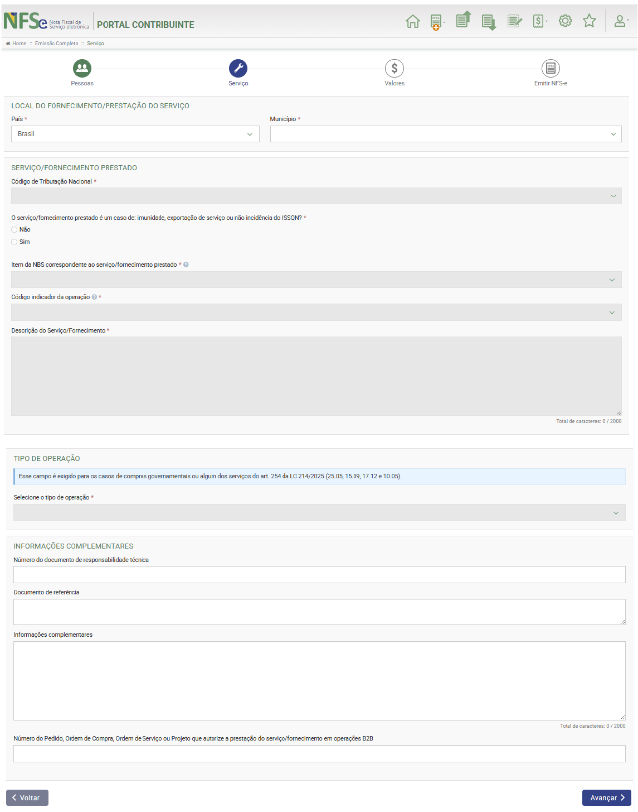

### LOCAL DO FORNECIMENTO/PRESTAÇÃO DO SERVIÇO

| Campo | Descrição | Tipo | Ocorrência | Ação |
|---|---|---|---|---|
| <!-- p.45 -->País | Informação sobre o país onde ocorreu a conclusão do serviço prestado | Combo | Obrigatório | Selecionar um dos países da lista constantes da TAB.PAIS_ISO2 do Anexo_A-Municipio_IBGE-Paises_ISO2-V1.00-Snnfse-20251210. |
| Município | Informação sobre o município onde ocorreu a conclusão do serviço prestado, quando o serviço for prestado no Brasil. | Combo | Obrigatório | Caso o país informado para a prestação do serviço seja “Brasil”, selecionar o município (digite pelo menos 3 caracteres para realizar a busca), onde ocorreu a conclusão do serviço prestado. |

### SERVIÇO/FORNECIMENTO PRESTADO

Alguns campos relativos ao serviço/fornecimento prestado somente serão disponibilizados dependendo do Código de Tributação Nacional informado.

Caso o Código de Tributação Nacional seja um dos casos de preenchimento obrigatório do Local da Prestação do serviço, **deve-se informar o Tomador/Adquirente do serviço** e o sistema exibirá a seguinte mensagem:

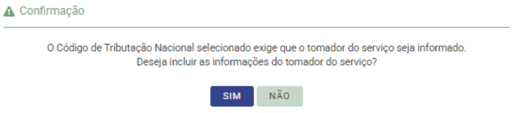

Informando “Sim”, o sistema exibirá uma tela para inclusão dos dados do Tomador/Adquirente, a ser preenchido conforme explicado no passo anterior (Pessoas):

<!-- p.46 -->
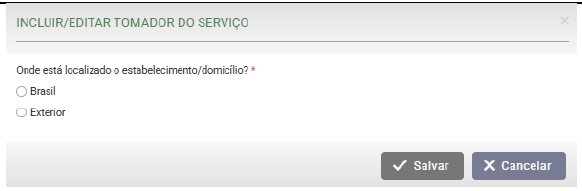

| Campo | Descrição | Tipo | Ocorrência | Ação |
|---|---|---|---|---|
| Código de Tributação Nacional | Informação sobre o Código de Tributação Nacional do serviço prestado. | Combo | Obrigatório | Selecionar o Código de Tributação Nacional constante do Anexo_B-Nbs2-Lista_Servico_Nacional-Snnfse-V1.01-20260122 (digite pelo menos 3 caracteres para realizar a busca). |
| Código Complementar do Município (Caso o município tenha criado códigos complementares) | Informação sobre o Código Complementar Municipal do serviço prestado. | Combo | Obrigatório | Selecionar o código complementar dentre as opções listadas. |
| O serviço prestado é um caso de: imunidade, exportação de serviço ou não incidência do ISSQN? | Informação se o serviço prestado é um caso de: imunidade, exportação de serviço ou não incidência do ISSQN. | Combo | Obrigatório | Marcar uma das opções: ○ Não ○ Sim |

Vários campos do terceiro passo (Valores) serão preenchidos a depender das opções feitas neste campo.

Se a resposta for “Não”, nenhuma informação adicional será necessária.

Se a resposta for “Sim”, outros campos abrirão para preenchimento.

<!-- p.47 -->
Caso se tenha optado por “Sim” no campo anterior, deve-se informar se é um caso de: Imunidade, Exportação de Serviço ou Não incidência do ISSQN:

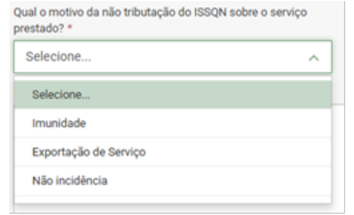

| Campo | Descrição | Tipo | Ocorrência | Ação |
|---|---|---|---|---|
| Qual o motivo da não tributação do ISSQN sobre o serviço prestado? | Informação se é um caso de “Imunidade” de tributação do ISSQN sobre o serviço prestado. | Combo | Obrigatório | Selecionar “Imunidade” caso seja a opção para não tributação do ISSQN sobre o serviço prestado. |

Selecionar uma das opções do Tipo de Imunidade para não incidência de ISSQN.

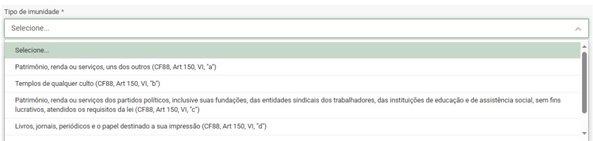

| Campo | Descrição | Tipo | Ocorrência | Ação |
|---|---|---|---|---|
| Qual o motivo da não tributação do ISSQN sobre o serviço prestado? | Informação se é um caso de “Exportação de Serviço” de tributação do ISSQN sobre o serviço prestado. | Combo | Obrigatório | Selecionar “Exportação de Serviço” caso seja a opção para não tributação do ISSQN sobre o serviço prestado. |

O sistema exibirá a seguinte mensagem no painel:

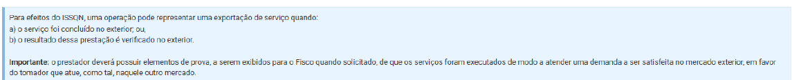

| Campo | Descrição | Tipo | Ocorrência | Ação |
|---|---|---|---|---|
| Informe o país em que se verificou o resultado do serviço prestado | Informação do país em que se verificou o resultado do serviço <!-- p.48 -->prestado | Combo | Obrigatório | Selecionar um dos países da lista constantes da TAB.PAIS_ISO2 do Anexo_A-Municipio_IBGE-Paises_ISO2-V1.00-Snnfse-20251210. |
| Qual o motivo da não tributação do ISSQN sobre o serviço prestado? | Informação se é um caso de “Não incidência” de tributação do ISSQN sobre o serviço prestado. Esta opção somente é possível se no campo “Código de Tributação Nacional” for informado o código 99.01.01 - Serviço sem incidência de ISSQN e ICMS ou para códigos de serviço configurados como não incidência de ISSQN no painel municipal do respectivo município. | Combo | Obrigatório | Preenchimento automático quando no campo “Código de Tributação Nacional” for informado o código 99.01.01 - Serviço sem incidência de ISSQN e ICMS ou para códigos de serviço configurados como não incidência de ISSQN no painel municipal do respectivo município. |

**IMPORTANTE:** Se o “Código de Tributação Nacional” informado não for o 99.01.01 ou algum cadastrado no respectivo município como não incidência, o sistema não permitirá esta seleção e exibirá a seguinte mensagem:

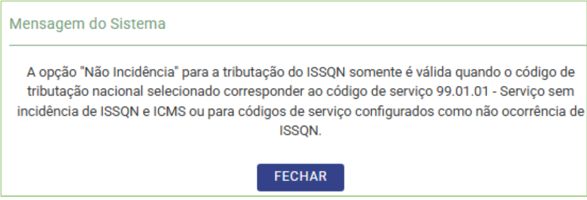

| Campo | Descrição | Tipo | Ocorrência | Ação |
|---|---|---|---|---|
| Município de incidência do ISSQN | Nome do Município de incidência do <!-- p.49 -->imposto.  Este campo será exibido a depender do “Código de Tributação Nacional”. Por exemplo: 17.05.01 – Fornecimento de mão-de-obra, mesmo em caráter temporário, inclusive de empregados ou trabalhadores, avulsos ou temporários, contratados pelo prestador/fornecedor de serviço. | Texto | Obrigatório | O Sistema Nacional NFS-e identifica a localidade de incidência do ISSQN conforme regras estabelecidas na LC 116/03.  Existem exceções em que o Sistema Nacional NFS-e não identifica a localidade de incidência nem haverá destaque do ISSQN na emissão da NFS-e: 1) Em caso de imunidade não existe localidade de incidência para o ISSQN; 2) Em caso de exportação de serviço não existe localidade de incidência para o ISSQN; 3) Em caso de serviços sem a incidência de ISSQN (cTribNac igual a 990101), não existe localidade de incidência para o ISSQN; 4) Em caso de operação tributável deve existir localidade de incidência para o ISSQN.  Inclusive para os serviços prestados para os subitens 03.04 e 22.01, se informado um município <!-- p.50 -->específico no local de prestação de serviço, conforme TAB.MUN_IBGE.  As exceções para não existir município de incidência do ISSQN nas NFS-e de serviços prestados para os subitens 03.04 e 22.01, respectivamente, são definidos abaixo: a) Em caso de Locação, sublocação, arrendamento, direito de passagem ou permissão de uso, compartilhado ou não, de ferrovia, rodovia, postes, cabos, dutos e condutos de qualquer natureza (subitem 03.04 da lista de serviço do Sistema Nacional NFS-e), se o local de prestação de serviço informado na DPS corresponder à localidade geral definida para este serviço (0000000, conforme TAB.LOC.GERAL), então não é identificada a localidade de incidência para o ISSQN na NFS-e (as informações das <!-- p.51 -->localidades de incidência do ISSQN para o serviço 03.04 ocorrerão na solicitação de apuração enviada pelo contribuinte ao MAN); |

| Campo | Descrição | Tipo | Ocorrência | Ação |
|---|---|---|---|---|
| Data de Competência | Data da competência da incidência do ISSQN. | Data | Obrigatório | Recupera a data de competência informada na tela inicial (Pessoas) |
| Item da NBS correspondente ao serviço/fornecimento prestado | Informação sobre a NBS - Nomenclatura Brasileira de Serviços | Combo | Obrigatório | Selecionar a NBS correspondente ao serviço prestado |
| Código indicador da operação (Preenchimento obrigatório para emissões com destaque de IBS/CBS) | Informação sobre o Código indicador da operação | Combo | Obrigatório | Selecionar o Código indicador da operação correspondente ao serviço prestado, conforme lista do AnexoVII-IndOp_IBSCBS |
| Descrição do Serviço | Descrição do serviço prestado | Texto | Obrigatório | Incluir uma descrição detalhada do serviço prestado |

### INFORMAÇÕES DO IMÓVEL

Campos que serão exibidos quando o Serviço/Fornecimento prestado forem relacionados a imóveis – Itens 020101, 020201 e 020301 do Código indicador da operação.

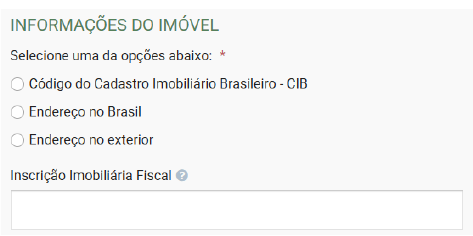

<!-- p.52 -->

**Obs.:** Caso sejam informados os subitens 07.02 e 07.05 do Código de Tributação Nacional, **ao invés de o sistema exibir os campos de “INFORMAÇÕES DO IMÓVEL”, serão exibidos os campos relativos a “INFORMAÇÕES PARA OBRA”**, que também contemplam as informações de imóveis.

#### Código do Cadastro Imobiliário Brasileiro – CIB

| Campo | Descrição | Tipo | Ocorrência | Ação |
|---|---|---|---|---|
| **Código do Cadastro Imobiliário Brasileiro CIB** - Somente permitido se a opção do Local da Prestação do Serviço for “Brasil” | Código do Cadastro Imobiliário Brasileiro | Texto | Obrigatório | Incluir o CIB |

#### Endereço no Brasil

**Endereço no Brasil** - Somente permitido se a opção do Local da Prestação do Serviço for “Brasil”

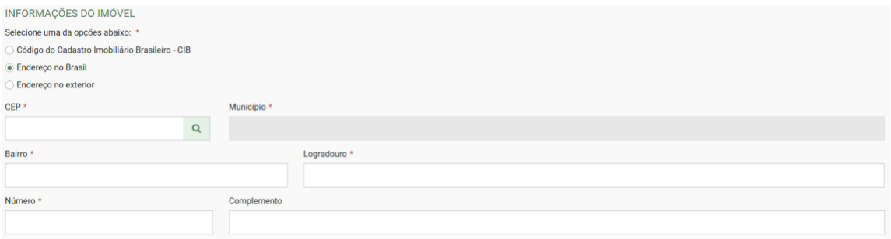

**Obs.:** O CEP a ser informado para endereço do imóvel deve pertencer ao município que foi informado como local da prestação do serviço.

| Campo | Descrição | Tipo | Ocorrência | Ação |
|---|---|---|---|---|
| CEP | Informação do número do CEP da obra. | Número | Obrigatório | Incluir o CEP da obra |
| Município | Informação do nome do município ao qual pertence a obra no Brasil | Texto | Obrigatório | O sistema recupera as informações de logradouro na tabela TOM com o CEP informado |
| Bairro | Informação do bairro | Texto | Obrigatório | O sistema recupera as informações de logradouro na tabela TOM com o CEP informado |
| Logradouro | Informação do nome do logradouro. | Texto | Obrigatório | O sistema recupera as informações de logradouro na tabela <!-- p.53 -->TOM com o CEP informado |
| Número | Informação do número do logradouro, | Texto | Obrigatório | Incluir o número do logradouro |
| Complemento | Informação do complemento do logradouro. | Texto | Opcional | Incluir o complemento do logradouro |

#### Endereço no exterior

**Endereço no Exterior** - Somente permitido se a opção do Local da Prestação do Serviço não for “Brasil”

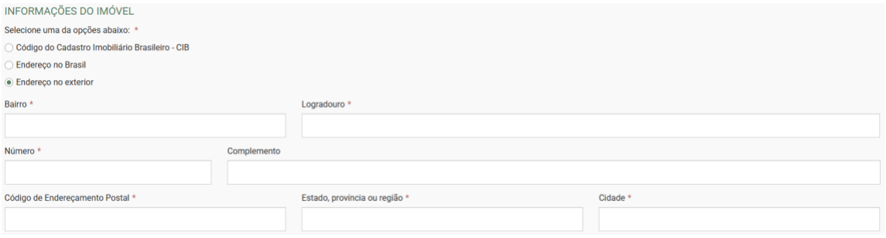

| Campo | Descrição | Tipo | Ocorrência | Ação |
|---|---|---|---|---|
| Bairro | Informação do bairro no exterior. | Texto | Obrigatório | Informar o bairro no exterior do local da obra. |
| Logradouro | Informação do nome do logradouro no exterior. | Texto | Obrigatório | Informar o logradouro no exterior do local da obra. |
| Número | Informação do número do logradouro | Texto | Obrigatório | Informar o número no exterior do local da obra. |
| Complemento | Informação do complemento do logradouro no exterior. | Texto | Opcional | Informar o complemento no exterior do local da obra. |
| Código de Endereçamento Postal | Informação do número do Código de endereçamento Postal no exterior. | Número | Obrigatório | Informar o código de endereçamento fiscal no exterior do local da obra. |
| <!-- p.54 -->Estado, província ou região | Informação do Estado, província ou região no exterior. | Texto | Obrigatório | Informar o no exterior Estado, província ou região do local da obra. |
| Cidade | Informação da cidade no exterior. | Texto | Obrigatório | Informar a cidade no exterior do local da obra. |
| **Inscrição Imobiliária Fiscal** | Código de inscrição imobiliária fornecida pela Prefeitura | Texto | Obrigatório | Incluir a inscrição imobiliária fiscal (código fornecido pela prefeitura para a identificação da obra ou para fins de recolhimento do IPTU). |

### INFORMAÇÕES PARA OBRA

Campos que serão exibidos quando o Serviço/Fornecimento prestado se referir a Obras – **Subitens 07.02 e 07.05 do Código de Tributação Nacional.** Deve-se marcar uma das opções de informação:

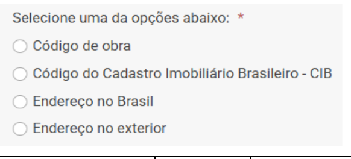

| Campo | Descrição | Tipo | Ocorrência | Ação |
|---|---|---|---|---|
| **Código da Obra** - Somente permitido se a opção do Local da Prestação do Serviço for Brasil - Somente permitido se a opção do Local da Prestação do Serviço for “Brasil” | Número de identificação da obra | Texto | Obrigatório | Incluir o código de obra |
| **Código do Cadastro <!-- p.55 -->Imobiliário Brasileiro CIB** - Somente permitido se a opção do Local da Prestação do Serviço for “Brasil” | Código do Cadastro Imobiliário Brasileiro | Texto | Obrigatório | Incluir o CIB |

#### Endereço no Brasil (obra)

**Endereço no Brasil** - Somente permitido se a opção do Local da Prestação do Serviço for “Brasil”

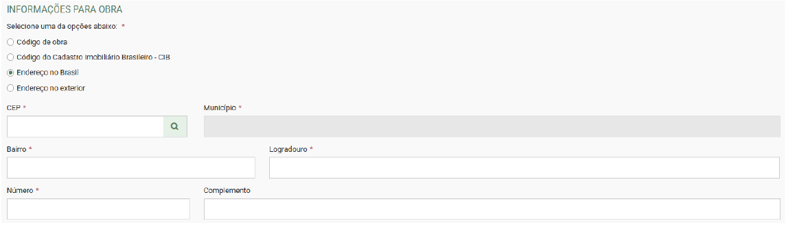

**Obs.:** O CEP a ser informado para endereço do imóvel deve pertencer ao município que foi informado como local da prestação do serviço.

| Campo | Descrição | Tipo | Ocorrência | Ação |
|---|---|---|---|---|
| CEP | Informação do número do CEP da obra. | Número | Obrigatório | Incluir o CEP da obra |
| Município | Informação do nome do município ao qual pertence a obra no Brasil | Texto | Obrigatório | O sistema recupera as informações de logradouro na tabela TOM com o CEP informado |
| Bairro | Informação do bairro | Texto | Obrigatório | O sistema recupera as informações de logradouro na tabela TOM com o CEP informado |
| Logradouro | Informação do nome do logradouro. | Texto | Obrigatório | O sistema recupera as informações de logradouro na tabela <!-- p.56 -->TOM com o CEP informado |
| Número | Informação do número do logradouro, | Texto | Obrigatório | Incluir o número do logradouro |
| Complemento | Informação do complemento do logradouro. | Texto | Opcional | Incluir o complemento do logradouro |

#### Endereço no exterior (obra)

**Endereço no Exterior** - Somente permitido se a opção do Local da Prestação do Serviço não for “Brasil”

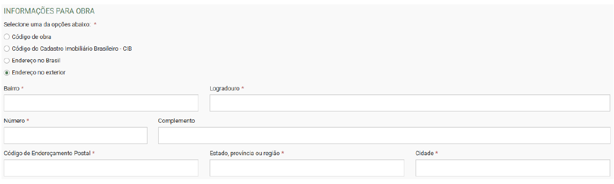

| Campo | Descrição | Tipo | Ocorrência | Ação |
|---|---|---|---|---|
| Bairro | Informação do bairro no exterior. | Texto | Obrigatório | Informar o bairro no exterior do local da obra. |
| Logradouro | Informação do nome do logradouro no exterior. | Texto | Obrigatório | Informar o logradouro no exterior do local da obra. |
| Número | Informação do número do logradouro | Texto | Obrigatório | Informar o número no exterior do local da obra. |
| Complemento | Informação do complemento do logradouro no exterior. | Texto | Opcional | Informar o complemento no exterior do local da obra. |
| Código de Endereçamento Postal | Informação do número do Código de endereçamento Postal no exterior. | Número | Obrigatório | Informar o código de endereçamento fiscal no exterior do local da obra. |
| Estado, província ou <!-- p.57 -->região | Informação do Estado, província ou região no exterior. | Texto | Obrigatório | Informar o no exterior Estado, província ou região do local da obra. |
| Cidade | Informação da cidade no exterior. | Texto | Obrigatório | Informar a cidade no exterior do local da obra. |
| **Inscrição Imobiliária Fiscal** | Código de inscrição imobiliária fornecida pela Prefeitura | Texto | Obrigatório | Incluir a inscrição imobiliária fiscal (código fornecido pela prefeitura para a identificação da obra ou para fins de recolhimento do IPTU). |

### INFORMAÇÕES PARA ATIVIDADE DE EVENTO

Campos que serão exibidos quando o serviço prestado se refere a atividades de Eventos – **Subitens do item 12 do Código de Tributação Nacional.**

| Campo | Descrição | Tipo | Ocorrência | Ação |
|---|---|---|---|---|
| Data Inicial | Data em que se iniciou a prestação do serviço | Data | Obrigatório | Incluir a data de início do serviço |
| Data Final | Data em que se foi ou será concluída a prestação do serviço | Data | Obrigatório | Incluir a data final do serviço |
| Descrição | Descrição do serviço prestado | Texto | Obrigatório | Incluir descrição do serviço |

Seleção de uma das formas de informação sobre o serviço prestado:

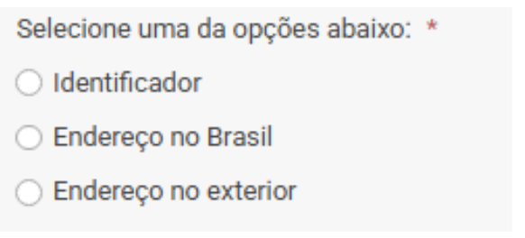

**Identificador** - Somente permitido se a opção do Local da Prestação do Serviço for “Brasil”

<!-- p.58 -->
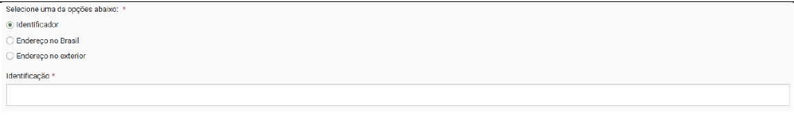

| Campo | Descrição | Tipo | Ocorrência | Ação |
|---|---|---|---|---|
| Identificação | Informação sobre o código identificador da atividade do evento determinado pela Administração Tributária | Código | Opcional | Incluir código de identificação da atividade do evento |

#### Endereço no Brasil (evento)

**Endereço no Brasil** - Somente permitido se a opção do Local da Prestação do Serviço for “Brasil”

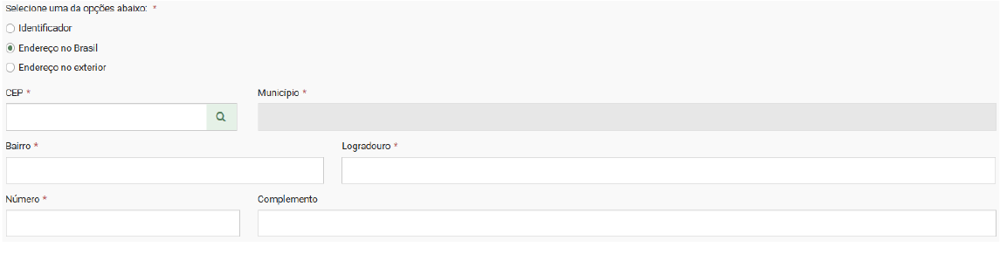

**Obs.:** O CEP a ser informado para endereço do imóvel deve pertencer ao município que foi informado como local da prestação do serviço.

| Campo | Descrição | Tipo | Ocorrência | Ação |
|---|---|---|---|---|
| CEP | Informação do número do CEP da obra. | Número | Obrigatório | Incluir o CEP do local do evento. |
| Município | Informação do nome do município ao qual pertence a obra no Brasil | Texto | Obrigatório | O sistema recupera as informações de logradouro na tabela TOM com o CEP informado |
| Bairro | Informação do bairro | Texto | Obrigatório | O sistema recupera as informações de logradouro na tabela TOM com o CEP informado |
| Logradouro | Informação do nome do logradouro. | Texto | Obrigatório | O sistema recupera as informações de logradouro na tabela <!-- p.59 -->TOM com o CEP informado |
| Número | Informação do número do logradouro, | Texto | Obrigatório | Incluir o número do logradouro do local do evento. |
| Complemento | Informação do complemento do logradouro. | Texto | Opcional | Incluir o complemento do logradouro do local do evento. |

#### Endereço no exterior (evento)

**Endereço no Exterior** - Somente permitido se a opção do Local da Prestação do Serviço não for “Brasil”

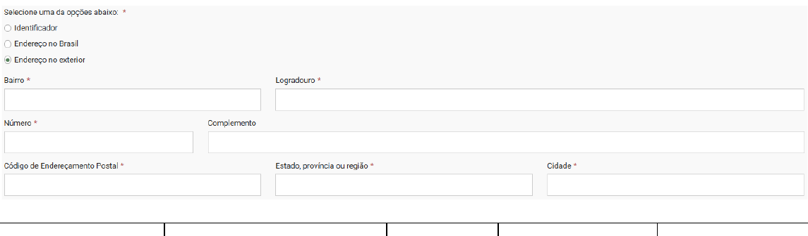

| Campo | Descrição | Tipo | Ocorrência | Ação |
|---|---|---|---|---|
| Bairro | Informação do bairro no exterior. | Texto | Obrigatório | Informar o bairro no exterior do local do evento. |
| Logradouro | Informação do nome do logradouro no exterior. | Texto | Obrigatório | Informar o logradouro no exterior do local do evento. |
| Número | Informação do número do logradouro | Texto | Obrigatório | Informar o número no exterior do local do evento. |
| Complemento | Informação do complemento do logradouro no exterior. | Texto | Opcional | Informar o complemento no exterior do local do evento. |
| Código de Endereçamento Postal | Informação do número do Código de endereçamento Postal no exterior. | Número | Obrigatório | Informar o código de endereçamento fiscal no exterior do local do evento. |
| Estado, província ou <!-- p.60 -->região | Informação do Estado, província ou região no exterior. | Texto | Obrigatório | Informar o no exterior Estado, província ou região do local do evento. |
| Cidade | Informação da cidade no exterior. | Texto | Obrigatório | Informar a cidade no exterior do local do evento. |

### INFORMAÇÕES PARA COMÉRCIO EXTERIOR

**INFORMAÇÕES PARA COMÉRCIO EXTERIOR** – Quando o País da Prestação/Fornecimento do serviço é diferente de Brasil, algumas informações adicionais são requisitadas.

Para a RFB, a prestação de serviço caracteriza-se como uma operação de comércio exterior quando existe ao menos um dos seguintes itens identificados/localizados no exterior: tomador/adquirente, intermediário ou local da prestação do serviço. Dessa forma, o emitente da DPS deverá prestar informações sobre esse tipo de transação, conforme apresentado a seguir:

| Campo | Descrição | Tipo | Ocorrência | Ação |
|---|---|---|---|---|
| Modo de Prestação | Informação sobre o modo de prestação do serviço, no âmbito do comércio exterior | Combo | Obrigatório | Selecionar uma das opções da lista disponibilizada: ○ Transfronteiriço ○ Consumo no Brasil ○ Movimento Temporário de Pessoas Físicas ○ Consumo no Exterior |
| Vínculo entre as partes no negócio | Informação sobre o vínculo entre as partes no negócio | Combo | Obrigatório | Selecionar um dos vínculos do serviço prestado da lista disponibilizada. ○ Sem vínculo com o tomador/prestador ○ Controlada ○ Controladora ○ Coligada ○ Matriz ○ Outro vínculo ○ Desconhecido |
| Moeda | Identifica a moeda <!-- p.61 -->da transação comercial. | Código | Obrigatório | Informar o código da moeda publicado na tabela de moedas do Banco Central do Brasil composto por 3 dígitos numéricos. |
| Valor do serviço/fornecimento em moeda estrangeira | Valor do serviço expresso na moeda estrangeira especificada | Valor | Obrigatório | Incluir o valor do serviço expresso na moeda estrangeira especificada |
| Mecanismo de apoio/fomento ao Comércio Exterior utilizado pelo prestador do serviço/fornecimento | Descreve o mecanismo de apoio/fomento ao Comércio Exterior utilizado pelo prestador do serviço/fornecimento. | Combo | Obrigatório | Selecionar o mecanismo de apoio/fomento ao Comércio Exterior utilizado pelo prestador/fornecedor do serviço dentre as opções da lista, por exemplo: ○ Nenhum; ○ ACC – Adiantamento sobre Contrato de Câmbio – Redução a zero do IR e do IOF; ○ ACE – Adiantamento sobre Cambiais Entregues – Redução a Zero do IR e do IOF; ○ BNDES-Exim Pós-Embarque – Serviços; ○ BNDES-Exim Pré-Embarque – Serviços. ○ FGE – Fundo de Garantia à Exportação ○ <!-- p.62 -->PROEX – Equalização ○ PROEX – Financiamento |
| Mecanismo de apoio/fomento ao Comércio Exterior utilizado pelo tomador do serviço/fornecimento | Mecanismo de apoio/fomento ao Comércio Exterior utilizado pelo tomador do serviço/fornecimento | Combo | Obrigatório | Selecionar o mecanismo de apoio/fomento ao Comércio Exterior utilizado pelo tomador/adquirente do serviço/fornecimento dentre as opções da lista, por exemplo: ○ Nenhum; ○ Adm. Pública e Repr. Internacional; ○ Aluguéis e Arrend. Mercantil de máquinas, equip., embarc. E aeronaves; ○ Arrendamento mercantil de aeronave para empresa de transporte aéreo público; ○ Comissão a agentes externos na exportação. ○ Despesas de armazenagem, mov. e transporte de carga no exterior ○ Eventos FIFA (subsidiária) ○ Eventos FIFA ○ <!-- p.63 -->Fretes, arrendamentos de embarcações ou aeronaves e outros ○ Material Aeronáutico ○ Promoção de Bens no Exterior ○ Promoção de Dest. Turísticos Brasileiros ○ Promoção do Brasil no Exterior ○ Promoção Serviços no Exterior ○ RECINE ○ RECOPA ○ Registro e Manutenção de marcas, patentes e cultivares ○ REICOMP ○ REIDI ○ REPENEC ○ REPES ○ RETAERO ○ RETID ○ Royalties, Assistência Técnica, Científica e Assemelhados ○ Serviços de avaliação da conformidade vinculados aos Acordos da OMC ○ ZPE |
| Existe vínculo da operação à movimentação <!-- p.64 -->temporária de bens? | Informação se Existe vínculo da operação à movimentação temporária de bens. | Combo | Obrigatório | Selecionar a opção do vínculo dentre a lista disponibilizada: ○ Não; ○ Vinculada – Declaração de Importação; ○ Vinculada – Declaração de Exportação. |

Se a opção acima for : “Vinculada – Declaração de Importação”, o contribuinte deve informar o número da declaração de Importação (DI/DSI/DA/DRI-E) averbado.

| Campo | Descrição | Tipo | Ocorrência | Ação |
|---|---|---|---|---|
| DI/DSI/DA/DRI-E averbado | Número da Declaração de Importação (DI/DSI/DA/DRI-E) averbado | Texto | Obrigatório | Incluir Número da Declaração de Importação (DI/DSI/DA/DRI-E) averbado |

Se a opção acima for : “Vinculada – Declaração de Exportação”, o contribuinte deve informar o Registro de Exportação (RE) averbado.

| Campo | Descrição | Tipo | Ocorrência | Ação |
|---|---|---|---|---|
| RE averbado | Número do Registro de Exportação (RE) averbado | Texto | Obrigatório | Incluir o Número do Registro de Exportação (RE) averbado |

| Campo | Descrição | Tipo | Ocorrência | Ação |
|---|---|---|---|---|
| Deseja compartilhar a NFS-e que será gerada desta DPS com o MDIC? | Informação sobre o compartilhamento da NFS-e que será gerada a partir desta DPS com o MDIC. | Combo | Obrigatório | Selecionar uma das opções: ○ Sim ○ Não |

### TIPO DE OPERAÇÃO

Esse campo é exigido para os casos de **compras governamentais** ou algum dos serviços dispostos no art. 254 da LC 214/2025 (**subitens 25.05, 15.09, 17.12 e 10.05, da lista de serviços**).

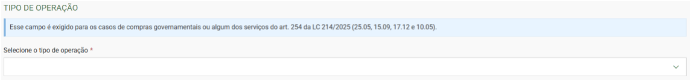

| Campo | Descrição | Tipo | Ocorrência | Ação |
|---|---|---|---|---|
| Tipo de Operação | Informação sobre Tipo de operação <!-- p.65 -->com entes governamentais ou outros serviços sobre bens imóveis | Combo | Obrigatório | Selecionar uma das opções da lista: 1. Fornecimento com pagamento posterior 2. Recebimento do pagamento com fornecimento já realizado 3. Fornecimento com pagamento já realizado 4. Recebimento do pagamento com fornecimento posterior 5. Fornecimento e recebimento do pagamento concomitantes |
| Chave da NFS-e | Informação da Chave de acesso da NFS-e com fornecimento ou recebimento do pagamento realizado (Opções 2 ou 3 do Tipo de Operação) | Valor | Obrigatório | Informar a chave de acesso da NFS-e que acobertou o fornecimento ou recebimento do pagamento realizado. Deve-se informar uma chave de acesso válida, com 50 caracteres alfanuméricos.  Caso seja informada uma chave de acesso inválida, o sistema exibirá a seguinte mensagem: “Para avançar, por favor verifique a seguinte situação: 1. Informe uma chave de NFS-e válida.” |

<!-- p.66 -->
### INFORMAÇÕES COMPLEMENTARES

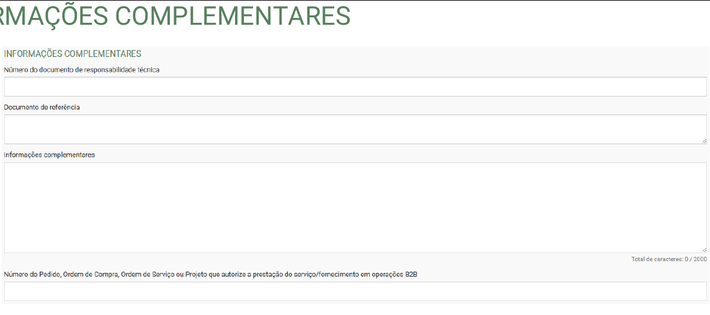

| Campo | Descrição | Tipo | Ocorrência | Ação |
|---|---|---|---|---|
| Número do documento de responsabilidade técnica | Informação sobre o número do documento de responsabilidade técnica | Texto | Opcional | Incluir o número do documento de responsabilidade técnica. |
| Documento de referência | Informação sobre documentos referenciados | Texto | Opcional | Incluir dados sobre o documento de responsabilidade técnica. |
| Informações Complementares | Descrição de informações complementares | Texto | Opcional | Incluir informações complementares sobre o serviço. |
| Número do Pedido, Ordem de Compra, Ordem de Serviço ou Projeto que autorize a prestação do serviço/fornecimento em operações B2B | Informação sobre número do pedido, ordem de compra etc. | Texto | Opcional | Incluir as referidas informações.  Será habilitado o botão **+ Incluir Item** para identificação de itens a serem incluídos no pedido, ordem de compra etc. |
| Incluir Item | Identificação de itens a serem incluídos no Pedido, Ordem de Compra, Ordem de Serviço ou Projeto <!-- p.67 -->que autorize a prestação do serviço/fornecimento em operações B2B. | Texto | Obrigatório | Incluir os itens que compõem as referidas informações de pedidos, ordem de compra etc. |

Após o preenchimento dos campos da etapa “Serviço”, clicar em **Avançar**.
