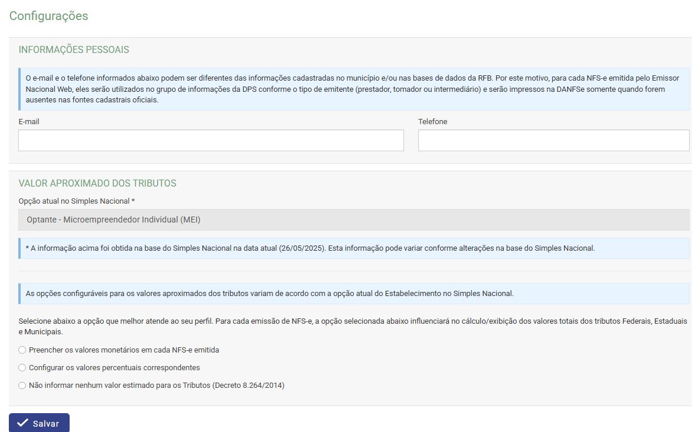

# 4.2.2 Configurações no menu principal

O sistema exibirá a seguinte tela:

Informar o e-mail e telefone e marcar a opção para os cálculos/exibição dos valores totais dos tributos Federais, Estaduais e Municipais.

Clicar no botão <!-- REVISAR p.89: rótulo do botão ausente no texto extraído --> e voltar para a emissão simplificada.
