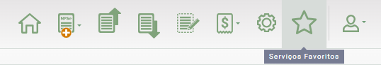
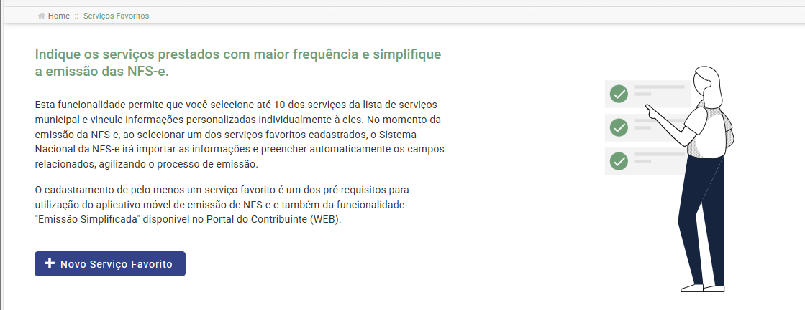
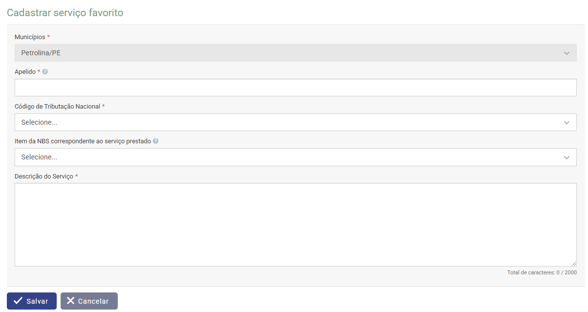
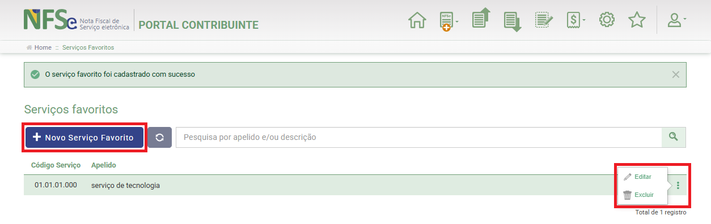

<!-- p.90 -->

# 4.2.3 Criando serviços favoritos

O sistema exibirá a tela abaixo para inclusão de serviço favorito.

Preencher os campos:

1) Apelido (termo que ajudará o emissor, posteriormente, a identificar o serviço pré-configurado dentro do Sistema Nacional da NFS-e. Deve ter no máximo 50 caracteres).
2) Código de Tributação Nacional – selecionar dentre os códigos da lista;
3) Item da NBS correspondente ao serviço prestado. A Nomenclatura Brasileira de Serviços Intangíveis e Outras Operações que Produzam Variações no Patrimônio (NBS) é o classificador nacional para a identificação dos serviços e viabiliza adequadamente a elaboração fiscalização e avaliação de políticas públicas de forma integrada. Selecionar dentre os valores cadastrados.
4) Descrição do serviço.

Após o preenchimento de todos os campos, clicar no botão <!-- REVISAR p.90: rótulo do botão ausente no texto extraído -->.

O serviço cadastrado será exibido na tela inicial, onde será possível editá-lo ou excluí-lo; ou, ainda, cadastrar um novo serviço favorito.

