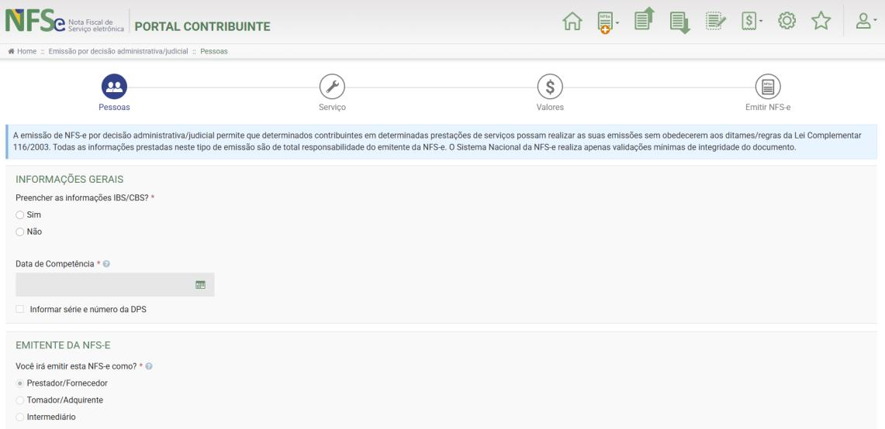
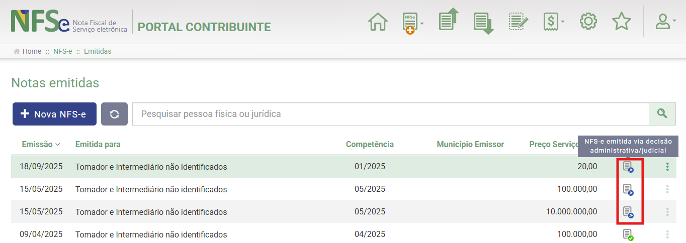

# 4.3.1 Inclusão de NFS-e por decisão administrativa/judicial

Para inclusão de uma nota referente a decisão administrativa ou judicial, deve-se clicar na opção "Emissão por decisão administrativa/judicial" existente no menu principal:

<!-- p.98 -->

Caso o contribuinte não esteja vinculado a nenhuma decisão administrativa/judicial em nenhum município conveniado, será apresentada a tela a seguir:

Caso contrário, se o usuário estiver vinculado a qualquer decisão administrativa/judicial, será exibida a tela abaixo para inclusão das informações:

A prestação das informações segue o mesmo fluxo de uma emissão normal, com algumas particularidades:

No passo "Pessoas":

- Informar a data de competência, observando o início de vigência do cadastro da decisão administrativa/judicial pelo município de emissão que autorizou o usuário a emitir uma NFS-e por decisão administrativa/judicial;

<!-- p.99 -->

- Informar os demais campos da tela, atentando para a possibilidade de informar o mesmo CPF/CNPJ do emitente como tomador/adquirente, destinatário e intermediário do serviço.

Para o passo "Serviço":

- Informar os campos obrigatórios na tela, atentando para a seleção do município de incidência, que neste caso não é recuperado automaticamente pelo sistema;
- Com relação ao "Código de Tributação Nacional", serão exibidos apenas os serviços cadastrados pelo município de emissão como parte de uma decisão administrativa/judicial favorável ao emitente desta NFS-e.
- O preenchimento dos grupos obra/imóvel, atividade de evento e comércio exterior é opcional.

Finalmente, no passo "Valores":

- É necessário informar todos os campos de valores, entre os quais: alíquota, base de cálculo e valor do ISSQN, tendo em vista que os cálculos automáticos não são realizados;
- Também é necessário informar os valores da NFS-e, p. ex. "Valor Líquido da NFS-e", que no fluxo normal são calculados automaticamente.

Após o preenchimento das informações nos passos anteriores, basta clicar em "Emitir NFS-e" para finalizar o processo.
