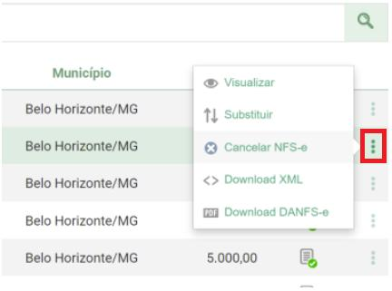
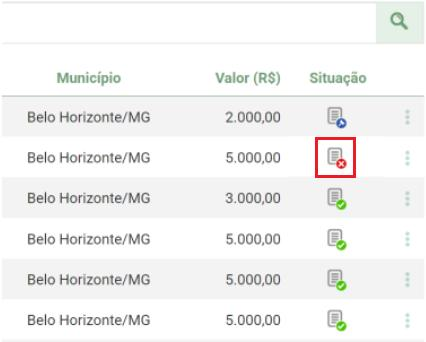

# 4.3.3 Cancelar NFS-e emitidas por decisão administrativa / judicial

Para cancelar uma nota emitida pelo fluxo de decisão administrativa/judicial, deve-se acessar a opção "NFS-e Emitidas" no menu principal e identificar a nota que deseja cancelar.

No menu lateral da nota desejada, selecionar a opção "Cancelar NFS-e" conforme a tela abaixo:

<!-- p.100 -->

Preencher as informações da janela aberta e clicar em "Cancelar NFS-e". A nota cancelada terá seu status alterado conforme a tela abaixo:

