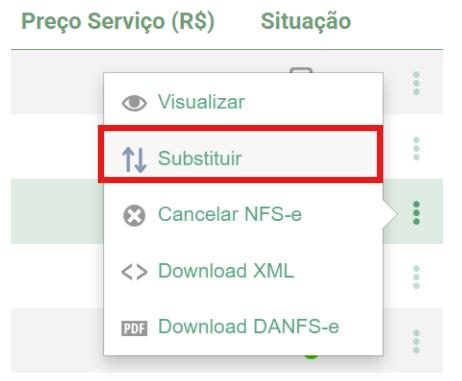
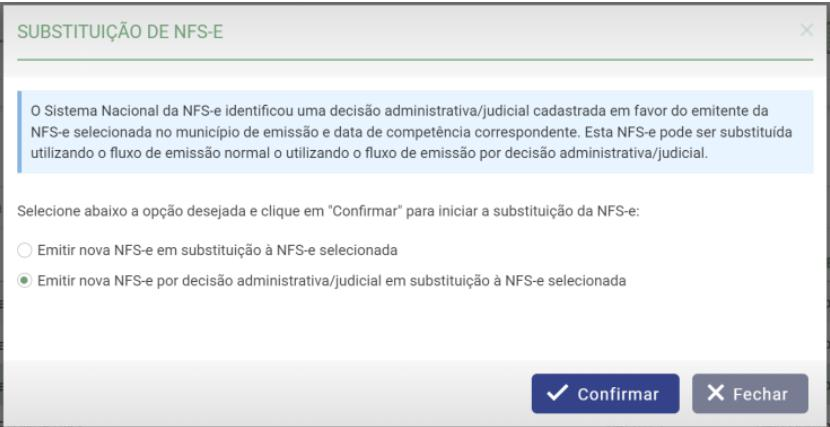

# 4.3.4 Substituir NFS-e emitida por decisão administrativa / judicial

Para substituir uma nota emitida por decisão administrativa/judicial, deve-se acessar a opção "NFS-e Emitidas" no menu principal e identificar a nota que deseja substituir.

No menu lateral, selecionar a opção "Substituir":

O sistema verificará se a nota selecionada pode ser substituída por outra emitida tanto pelo fluxo padrão quanto pelo fluxo de decisão administrativa ou judicial. Caso essa substituição seja possível, será exibida uma janela para que o emitente escolha qual fluxo deseja utilizar:

<!-- p.101 -->

Após selecionar o fluxo desejado e clicar em "Confirmar", o sistema irá direcionar para o fluxo de emissão por substituição.
