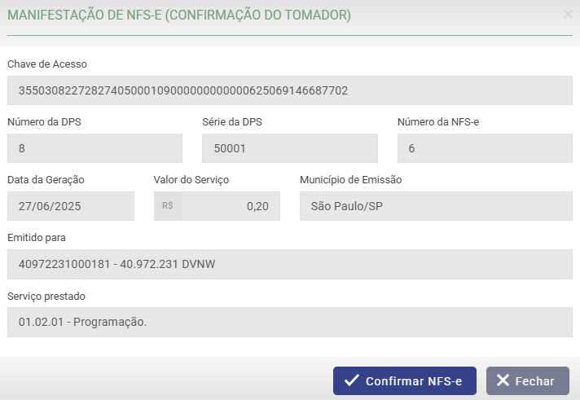

<!-- p.111 -->

# 6.4.1 Confirmar uma NFS-e

Ao consultar a área de Notas Recebidas, o usuário poderá acionar o comando "Confirmar" do menu disponibilizado caso reconheça a NFS-e emitida para ele como tomador/adquirente de serviço de um outro emitente. Esta ação gera um arquivo XML (evento de manifestação), conforme leiaute definido no ANEXO_I-SEFIN_ADN-DPS_NFSe-SNNFSe e, que será processado, armazenado e vincula à NFS-e correspondente.

Ao clicar em "Confirmar", o sistema exibirá uma tela com um resumo da NFS-e emitida, conforme modelo abaixo:

Caso o usuário reconheça a NFS-e emitida para ele, deve clicar no botão <!-- REVISAR p.111: rótulo do botão ausente no texto extraído -->.
