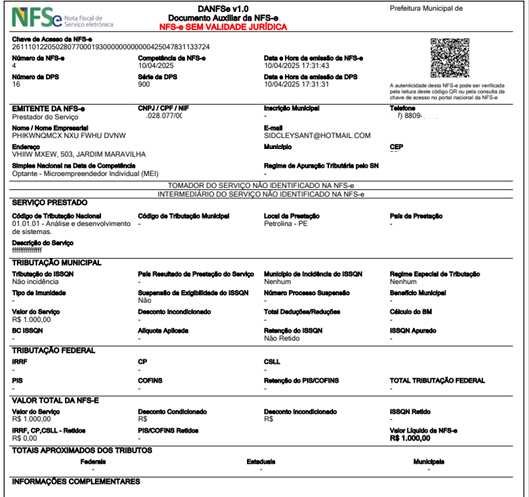
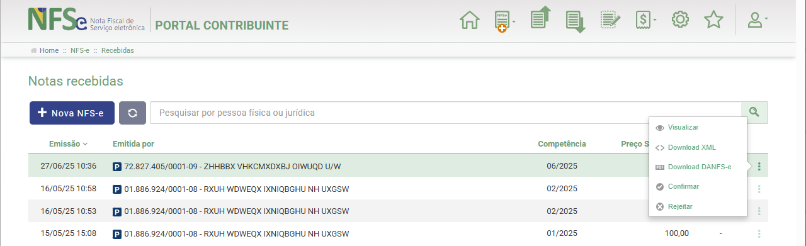

<!-- p.108 -->

# 6 Consulta NFS-e Recebidas

Nesta página é possível realizar a consulta às NFS-e emitidas por outros usuários, onde o usuário emitente figura como tomador/adquirente ou intermediário. O usuário pode filtrar, de uma listagem disponibilizada as notas conforme filtros descritos no campo de pesquisa da aplicação.

<!-- p.109 -->

O sistema vai totalizar o quantitativo de registros que atendem aos critérios de buscas (Total NFS-e recebidas) e exibir na tela o campo totalizador das NFS-e recebidas, desde o início de utilização do sistema até a data presente de visualização da consulta pelo usuário.

Outras ações podem ser realizadas para cada uma das notas listadas:

- Visualizar NFS-e (visualização no navegador do emitente em formato web);
- Baixar o XML da NFS-e (baixa o arquivo XML da NFS-e);
- Baixar o DANFSe (Documento Auxiliar de Nota Fiscal de Serviço eletrônica – representação gráfica da NFS-e com informações resumidas da nota) em formato PDF;
- Confirmar;
- Rejeitar.
- Iniciar uma nova emissão através do botão Nova NFS-e.
