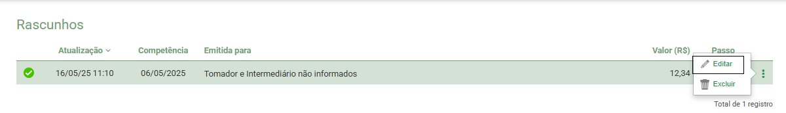
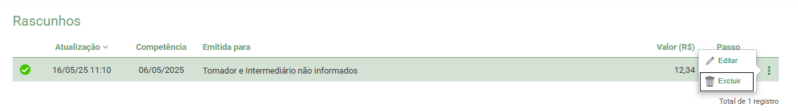

# 7 Rascunho DPS

Esta funcionalidade permite que o emitente possa concluir o preenchimento e enviar a DPS para a geração da NFS-e em um momento posterior.

O principal uso desta funcionalidade é devido à perda de conexão do link de internet com o Emissor Web. O sistema "salva o rascunho" automaticamente a cada 5 segundos, contendo as informações da DPS que estão sendo preenchidas, para que o emitente possa retornar em outro momento e, do ponto onde parou, continuar o preenchimento conforme demonstrado na coluna passo da tela abaixo.

| Campo | Descrição | Tipo | Ocorrência | Ação |
|---|---|---|---|---|
| Atualização | Informação da data da última atualização do rascunho | Data | Obrigatório | Recuperado pelo sistema |
| Competência | Informação da data competência da NFS-e | Data | Obrigatório | Recuperado pelo sistema |
| Emitida para | Identificação sobre para quem foi emitida a NFS-e | Texto | Obrigatório | Recuperado pelo sistema |
| Valor | Informação sobre o valor total da NFS-e emitida | Valor | Obrigatório | Recuperado pelo sistema |
| Passo | Identificação em qual passo de emissão a DPS está | Ícone | Obrigatório | Recuperado pelo sistema |

<!-- p.114 -->

| Campo | Descrição | Tipo | Ocorrência | Ação |
|---|---|---|---|---|
| Ações no registro | Informação sobre as possíveis ações para o rascunho da DPS | Ícone | Obrigatório | Direcionar para ação selecionada: Editar; Excluir |

