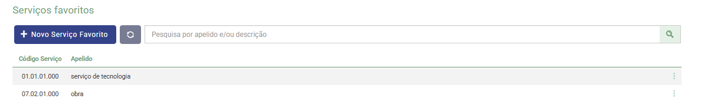

<!-- p.115 -->

# 8 Serviços Favoritos

Esta funcionalidade permite ao emitente gravar informações conforme tela abaixo para facilitar o preenchimento dos campos no passo 2 do Emissor Web. Estes registros servem também ao Emissor Móvel, que os utiliza para o preenchimento de informações na DPS simplificada.

Ao clicar o botão <!-- REVISAR p.115: rótulo do botão ausente no texto extraído -->, o sistema exibirá a tela para o preenchimento dos seguintes campos:

1) Apelido (termo que ajudará o emissor, posteriormente, a identificar o serviço pré-configurado dentro do Sistema Nacional da NFS-e. Deve ter no máximo 50 caracteres).
2) Código de Tributação Nacional – selecionar dentre os códigos da lista;
3) Item da NBS correspondente ao serviço prestado. A Nomenclatura Brasileira de Serviços Intangíveis e Outras Operações que Produzam Variações no Patrimônio (NBS) é o classificador nacional para a identificação dos serviços e viabiliza adequadamente a elaboração fiscalização e avaliação de políticas públicas de forma integrada. Selecionar dentre os valores cadastrados.
4) Descrição do serviço.

Após o preenchimento de todos os campos, clicar no botão <!-- REVISAR p.115: rótulo do botão ausente no texto extraído -->.

O serviço cadastrado será exibido na tela inicial, onde será possível editá-lo ou excluí-lo; ou, ainda, cadastrar um novo serviço favorito.

<!-- p.116 -->

| Campo | Descrição | Tipo | Ocorrência | Ação |
|---|---|---|---|---|
| Municípios | Informação sobre o município para o qual será criado o serviço favorito | Texto | Obrigatório | Recupera dos cadastros RFB ou CNC conforme convênio do município |
| Apelido | Termo para identificar posteriormente o serviço pré-cadastrado no sistema da NFS-e | Texto | Obrigatório | Incluir apelido para o serviço |
| Código de Tributação Nacional | Informação do Código de Tributação Nacional | Combo | Obrigatório | Selecionar o código de tributação nacional aplicável ao serviço da lista |
| Item da NBS correspondente ao serviço selecionado | Informação da Nomenclatura Brasileira de Serviços | Combo | Obrigatório | Selecionar a NBS aplicável ao serviço da lista |
| Descrição do serviço | Descrição do serviço prestado | Texto | Obrigatório | Incluir a descrição do serviço prestado |
