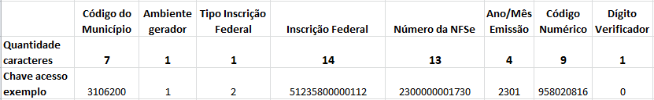
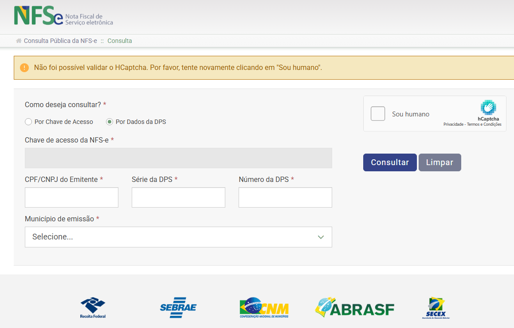

# 9.1 Consulta usando a chave de acesso da NFS-e

A chave de acesso da NFS-e serve como um "código de identificação" da nota fiscal, permitindo que os envolvidos no processo fiscal façam as suas consultas.

A chave de acesso é composta por 50 caracteres alfanuméricos, sendo que cada dígito ou conjunto de dígito representa uma informação sobre a nota fiscal e a empresa emitente do documento.

Exemplo de uma Chave de Acesso e sua composição:

- Código do Município: Código do município do endereço do emitente. Para consultar o nome do município através do código, acesse: Códigos dos municípios IBGE
- Ambiente gerador: Ambiente gerador da NFS-e: 1- Sistema Próprio do Município, 2- Sefin Nacional NFS-e.
- Tipo Inscrição Federal: 1-CPF, 2-CNPJ
- Inscrição Federal: Se for CPF completar com 000 à esquerda.
- Número da NFSe: Número da NFS-e (Sequencial pelo emitente)

<!-- p.118 -->

- Ano/Mês Emissão: Ano e mês que a nota foi emitida.
- Código Numérico: Código numérico de 9 posições, aleatório, gerado automaticamente pelo sistema gerador da NFS-e.
- Dígito Verificador: Dígito verificador do código numérico.

Deve-se preencher a chave de acesso, preencher o hCaptcha e clicar no botão <!-- REVISAR p.118: rótulo do botão ausente no texto extraído -->.

