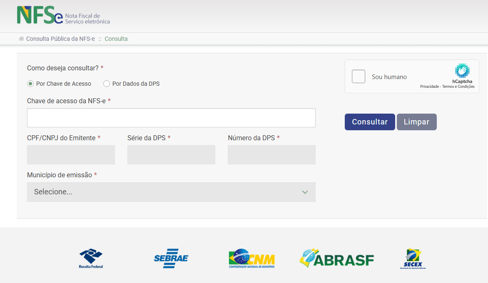

# 9 Consulta Pública de uma NFS-e

Com a unificação dos sistemas de NFS-e no Brasil, a chave de acesso nacional ajuda a padronizar o processo de emissão e controle de notas fiscais, eliminando as diferenças regionais que dificultavam a integração de sistemas entre municípios e empresas de diferentes localidades.

A consulta pública é disponibilizada a todos os envolvidos no processo fiscal (prestadores, tomadores e órgãos fiscalizadores) para que realizem consultas e validações do documento em <!-- p.117 --> plataformas digitais que tiverem os dados de emissão.

A consulta a uma NFS-e é possível através do site NFS-e | Consulta Pública de NFS-e, onde será exigido o preenchimento de alguns parâmetros.

