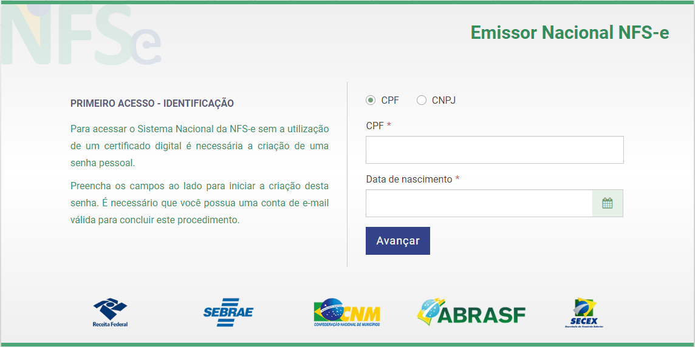
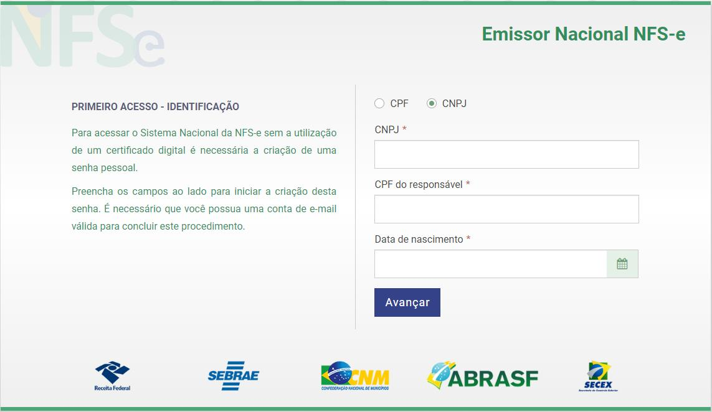
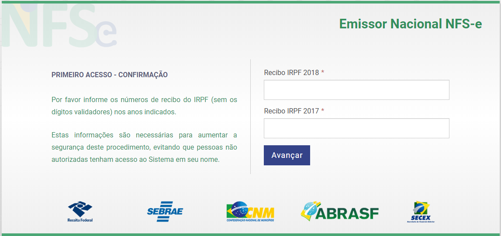
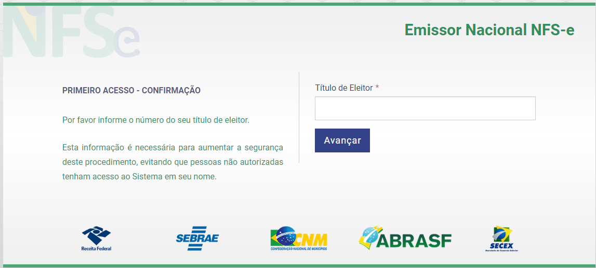
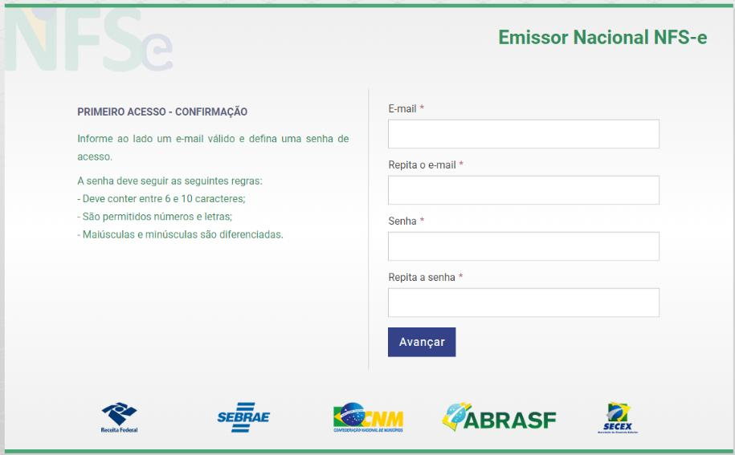

# 10.3 Realizar primeiro acesso ao Sistema Nacional NFS-e

O Cadastramento de Login/Senha no Sistema Nacional da NFS-e será realizada pelo próprio usuário no Portal Nacional NFS-e.

Para utilizar esta funcionalidade o usuário deve possuir os números de recibos das Declarações do Imposto de renda Pessoa Física (DIRPF) dos últimos 2 anos. Durante o processo de cadastramento será solicitado os números dos recibos de entrega das Declarações do Imposto de renda Pessoa Física (DIRPF) dos exercícios referentes às declarações ativas (últimas entregues) das quais o CPF do contribuinte seja titular.

Se a geração de senha for para um CNPJ, os números de recibo das DIRPF que devem ser informados são os do CPF que seja responsável legal pelo CNPJ.

Em caso de existência de registro de declaração de somente um dos últimos exercícios, será obrigatório que o contribuinte informe o número do recibo referente à declaração ativa (última entrega) deste ano.

Caso o usuário não tenha nenhum recibo da DIRPF será utilizado o título de eleitor para o cadastramento do Login/Senha, obtido do cadastro CPF da RFB.

<!-- p.120 -->

Caso não possua título de eleitor, não será possível criação de usuário/senha e o usuário será instruído a comparecer presencialmente ao município em que seja emitente para ser cadastrado no sistema. Outra opção sem a necessidade de comparecimento presencial poderá ser o acesso ao sistema por certificado digital.

Ao final, o processo de primeiro acesso realizado é registrado na tabela de log do sistema.

<!-- p.121 -->

