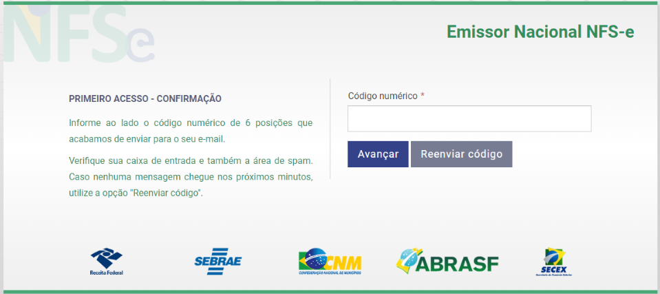
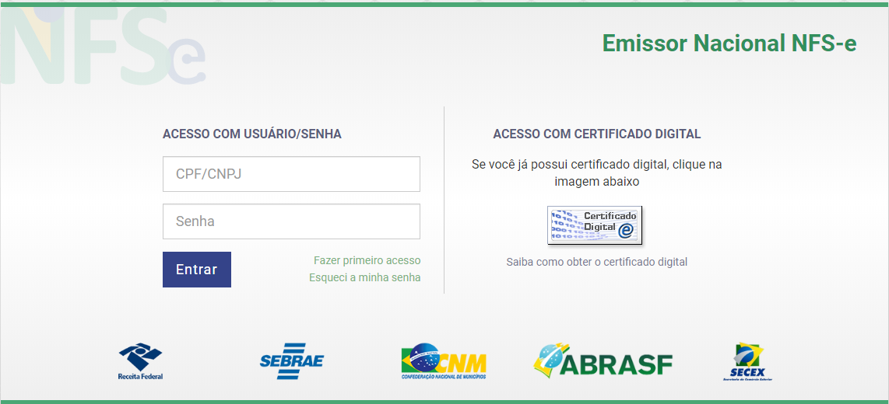
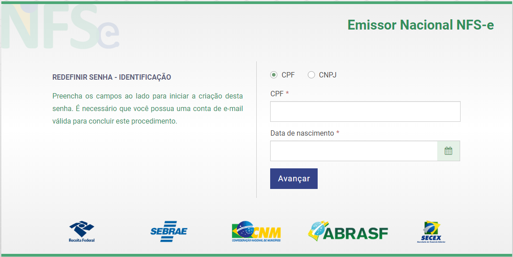
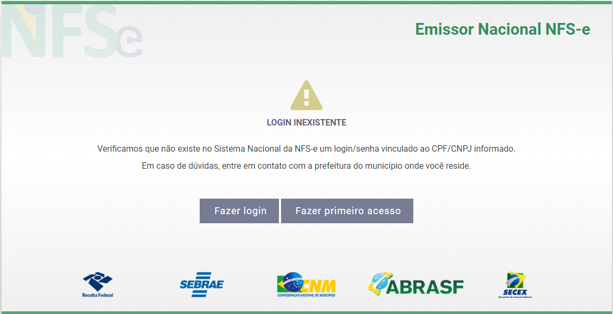
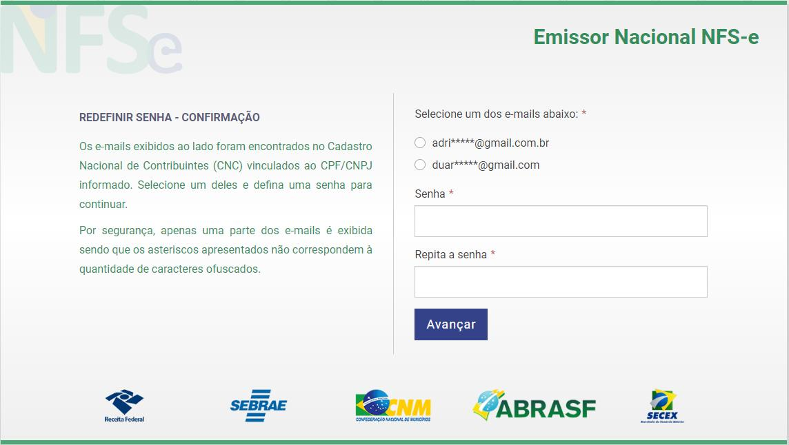
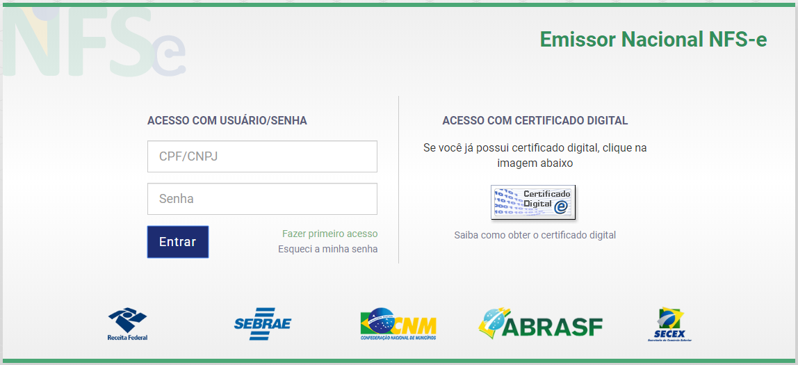

<!-- p.122 -->

# 10.4 Recuperar senha do usuário

O processo para recuperação de senha, caso o usuário já tenha se cadastrado, segue praticamente o mesmo fluxo realizado no primeiro acesso, exceto pelo início do processo em que o usuário já poderá acionar a recuperação de senha desde o início, sem realizar o primeiro acesso pois este fluxo já foi realizado. Segue abaixo as telas para melhor entendimento.

<!-- p.123 -->

Caso o CPF ou CNPJ digitados não sejam encontrados no Sistema Nacional NFS-e, o sistema apresenta a tela a seguir para que o usuário opte por realizar o login com um CPF/CNPJ reconhecido pelo sistema ou que possa realizar todo o processo de primeiro acesso, conforme telas do item "Realizar primeiro acesso ao Sistema Nacional NFS-e" deste documento.

Durante os processos de primeiro acesso e recuperação de senha de usuário, a existência dos CNPJ ou CPF informados pelo usuário, os números da última ou das duas últimas declarações de imposto de renda pessoa física e o título de eleitor do CPF informado ou do CPF responsável pelo CNPJ são verificados nos respectivos cadastros da RFB.

Caso o CPF ou CNPJ sejam encontrados, ou seja, o usuário já tenha realizado o primeiro acesso ao sistema, o Sistema Nacional NFS-e exibe os e-mails cadastrados vinculados ao CPF ou CNPJ para que o usuário possa escolher qual e-mail deseja que o sistema envie o link para redefinição de senha.

Ao final, o processo de recuperação de senha realizada é registrado na tabela de log do sistema.
