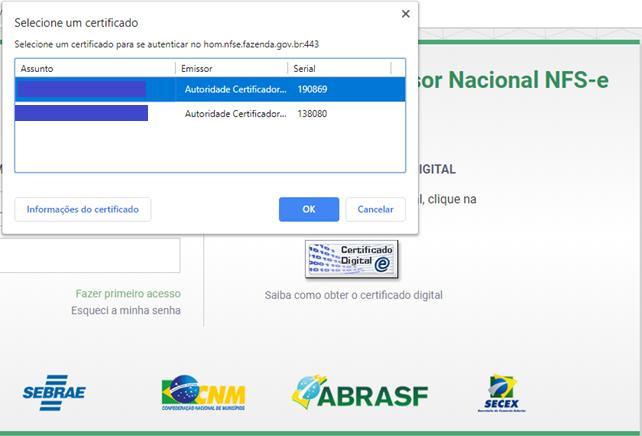

# 10.6.3 Controle de Acesso ao Sistema Nacional NFS-e via GOV.BR

A integração com GOV.BR pode ser utilizada para autenticação e acesso ao Emissor Web da NFS-e. A partir da implantação, em ambiente de produção, da evolução que permite alternar perfis no Emissor Web (próximo tópico deste guia), o acesso pelo GOV.BR passou a ser possível para todos os contribuintes, não apenas para o MEI.

**a. Níveis de Acesso GOV.BR aceitos pelo Emissor Web**

Serão aceitos os níveis prata e ouro do GOV.BR para acesso ao Emissor Web da NFS-e por pessoa física. O nível bronze foi considerado insuficiente para os padrões mínimos de segurança exigidos pelo sistema.

Importante observar que a forma de acesso ao emissor Web via login e senha também é possível para todos os prestadores/fornecedores (para a criação da senha de acesso, o cadastramento, "Fazer primeiro acesso", continuará sendo necessário), sendo o GOV.BR apenas mais uma opção de acesso a ser oferecida (sem a necessidade de cadastramento prévio no Emissor Web).

Não há qualquer restrição ao acesso em relação à forma utilizada pelo usuário (login e senha, certificado digital, etc.) desde que tenha os níveis prata ou ouro.

**b. Acesso ao GOV.BR**

O acesso por meio do GOV.BR é vinculado à pessoa física (CPF). Assim, ao realizar o login, a <!-- p.126 --> sessão será iniciada no perfil correspondente ao CPF utilizado na autenticação.

Na página inicial, na seção "Meus Dados", serão apresentadas as informações cadastrais desse CPF. Nesse perfil, o usuário poderá consultar as notas fiscais recebidas e, caso esteja cadastrado como contribuinte no Cadastro Nacional de Contribuintes (CNC) de algum município, também poderá emitir documentos fiscais em seu próprio nome.

Após iniciar a sessão, caso deseje atuar em nome de uma pessoa jurídica, o usuário poderá alternar para o perfil de um CNPJ do qual seja responsável legal ou para o qual possua procuração eletrônica válida. Para isso, deverá utilizar a funcionalidade de alternância de perfis descrita no tópico seguinte.

**c. Exceção para o MEI**

Caso o CPF utilizado no login via GOV.BR seja o responsável legal por um CNPJ enquadrado como MEI, o acesso ao Emissor Web será realizado diretamente no perfil do respectivo CNPJ, e não no perfil da pessoa física (CPF). Trata-se de um comportamento específico para essa situação, distinto da regra geral descrita no item "b".

Essa exceção foi mantida para preservar a experiência já conhecida pelos usuários MEI. Isso ocorre porque, até a disponibilização da funcionalidade de alternância de perfis, o acesso por meio do GOV.BR era exclusivo para MEIs. Assim, por razões de continuidade e previsibilidade, optou-se por manter o mesmo comportamento de acesso já adotado e esperado por esses usuários.
