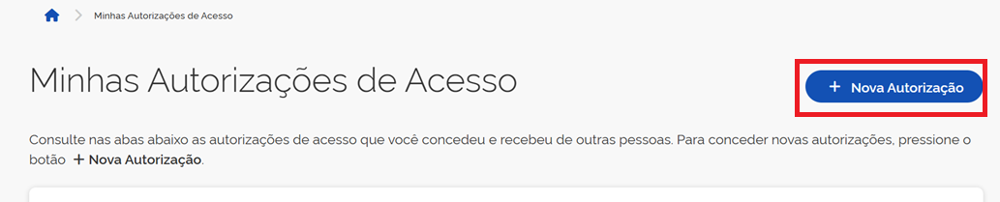
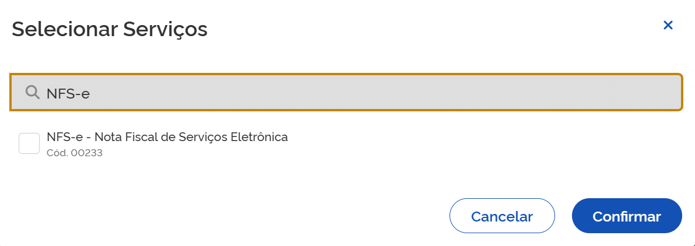

# 11.1.1 Procuração Eletrônica

A gestão de procurações eletrônicas relacionadas à NFS-e é realizada por meio do Portal de Serviços da Receita Federal, disponível em: https://servicos.receitafederal.gov.br/

Foi disponibilizado um serviço específico para a NFS-e, por meio do qual uma pessoa física (CPF) ou pessoa jurídica (CNPJ) pode conceder poderes a outra pessoa física ou jurídica para atuar em seu nome nos serviços da NFS-e.

Para cadastrar uma nova procuração, o usuário deve acessar o Portal de Serviços e selecionar a opção "Nova Autorização", conforme imagem abaixo. Em seguida, deverá informar o CPF ou CNPJ do procurador (pessoa que receberá os poderes) e definir o período de vigência da autorização.

<!-- p.127 -->

Após informar os dados do procurador e a vigência da procuração, o usuário deverá selecionar o serviço específico da NFS-e na relação de serviços disponíveis, conforme demonstrado na imagem a seguir. Concluída a seleção, basta confirmar e assinar eletronicamente a autorização.

Uma vez concedida a procuração, o procurador poderá atuar em nome do outorgante (pessoa que concedeu os poderes) nos limites da autorização concedida. Entre as funcionalidades disponíveis estão:

- Utilizar os serviços da NFS-e por meio das integrações via API (emissão e distribuição), conforme previsto na documentação técnica;
- Acessar o Emissor Web da NFS-e em nome do outorgante.
