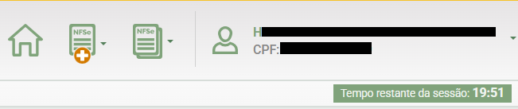
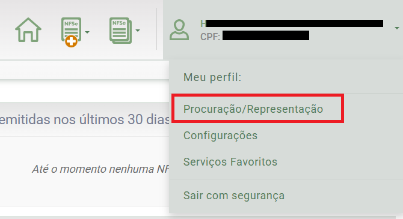
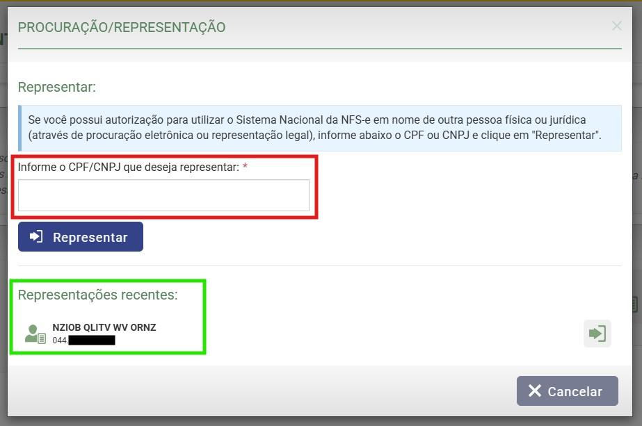
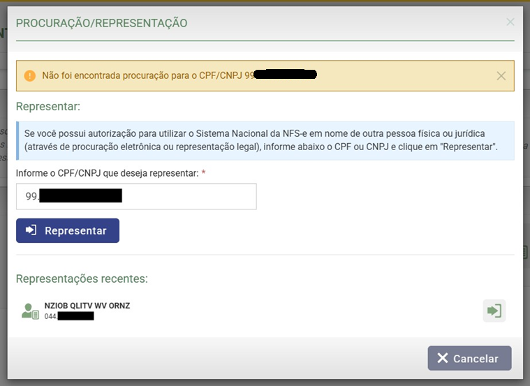

# 11.2 Como Alternar Perfis no Emissor Web

Após realizar o login no Emissor Nacional da NFS-e por uma das formas de autenticação disponíveis (Login e Senha, Certificado Digital ou GOV.BR), as informações do usuário serão exibidas no canto superior direito da tela, conforme ilustrado abaixo (também foi incluído um timer regressivo com a informação do tempo restante da sessão que foi estabelecida).

Para acessar a funcionalidade de representação, clique na seta localizada à direita da identificação do usuário. Em seguida, selecione a opção "Procuração/Representação" no menu de perfil, conforme demonstrado na imagem abaixo.

Ao selecionar a opção "Procuração/Representação", será exibida a seguinte janela:

<!-- p.129 -->

No campo destacado em vermelho, o procurador ou representante deverá informar o CPF ou CNPJ da pessoa física ou jurídica que deseja representar, observadas as regras de autorização descritas nos tópicos Procuração Eletrônica e Integração com a Base CNPJ. Após informar o CPF/CNPJ que deseja representar, clique no botão "Representar".

O sistema também disponibiliza o quadro "Representações Recentes", destacado em verde na imagem acima. Nesse quadro são exibidas as representações anteriormente realizadas pelo usuário. Para acessar novamente uma dessas representações, basta clicar no ícone de seta localizado à direita do respectivo registro, sem a necessidade de informar novamente o CPF ou CNPJ.

Caso o CPF ou CNPJ informado não possua vínculo de representação válido de acordo com as regras descritas nos tópicos Procuração Eletrônica e Integração com a Base CNPJ, o sistema exibirá uma mensagem de erro semelhante à apresentada abaixo:

<!-- p.130 -->

Quando a representação for validada com sucesso, o sistema realizará automaticamente a alteração do perfil ativo.

No canto superior direito da tela serão exibidos:

- o nome e o CPF ou CNPJ da pessoa física ou jurídica representada;
- a identificação do procurador ou representante que está realizando o acesso;
- um aviso em destaque informando que o usuário está atuando em nome de terceiros.

A partir desse momento, o procurador ou representante poderá utilizar as funcionalidades disponíveis no Emissor Nacional da NFS-e em nome da pessoa física ou jurídica representada, observadas as autorizações e os limites definidos para a representação.

**OBSERVAÇÃO:** De forma análoga ao Emissor Web, também será possível acessar as APIs de Emissão (https://sefin.nfse.gov.br/SefinNacional/docs/index#operation/NFSe_Post) e de Distribuição (https://adn.nfse.gov.br/contribuintes/docs/index.html#tag/DistribuicaoContribuinte) com base no serviço NFS-e criado no Procurações Eletrônicas ou nas integrações com a base cadastral CNPJ. As validações se darão a partir do certificado digital utilizado nas conexões com as APIs e as assinaturas dos emitentes dos documentos.
