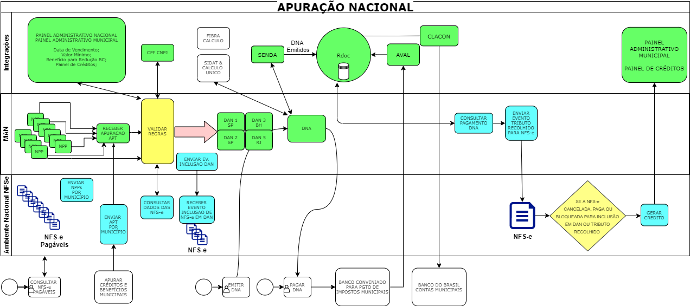

<!-- p.07 -->

# 1.4 Integrações do MAN

O Módulo de Apuração Nacional – MAN é um sistema cuja principal finalidade é possibilitar ao contribuinte do ISSQN recolher o imposto para o município através de um documento de arrecadação único e padronizado nacionalmente.

Para realizar esta finalidade, o sistema realizará integrações com outros sistemas já existentes inseridos no contexto nacional e que atendem a todos os municípios.

<!-- p.08 -->

Seguem abaixo as descrições de todas as integrações identificadas do MAN com outros módulos do SN NFS-e e com outros sistemas externos que são fundamentais para o funcionamento completo do MAN.
