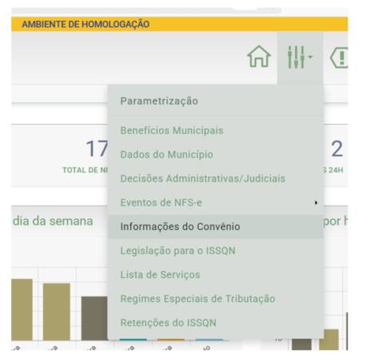
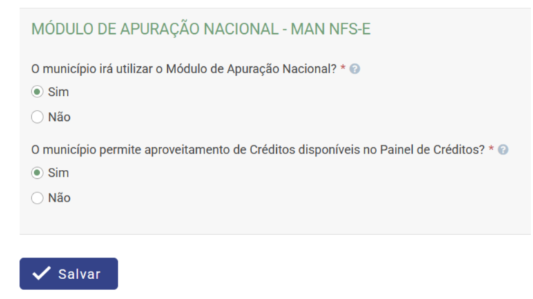

<!-- p.11 -->

# 2.1.2 Ativar o Módulo de Apuração Nacional

Abrir o menu “Parametrização” e clicar em “Informações do Convênio” para acessar a tela de configuração do convênio.

Na parte inferior da tela, onde aparecem as questões “O município irá utilizar o Módulo de Apuração Nacional?” e “O município permite aproveitamento de Créditos disponíveis no Painel de Créditos?”, escolher a opção “Sim” para ambas e clicar em “Salvar”.

