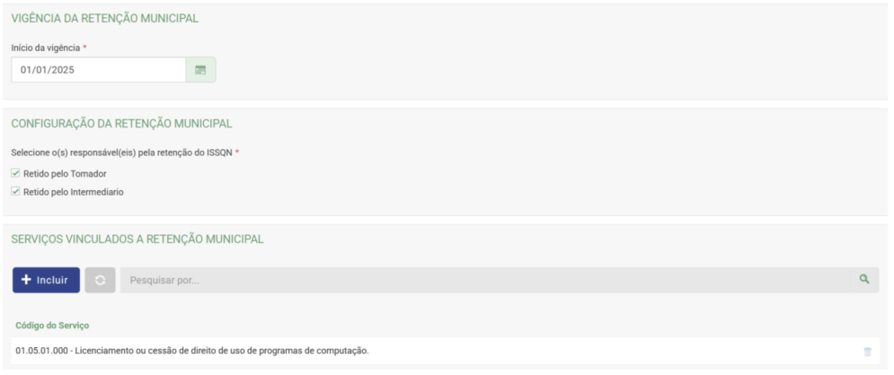

# 2.1.3 Configurar as retenções do ISSQN

Para que notas emitidas por terceiros com retenção do ISSQN pelo Tomador/Adquirente ou Intermediário para determinados serviços ou responsáveis tributários cadastrados no convênio sejam apuradas no MAN, é necessário antes configurar as Retenções do ISSQN no Painel Municipal.

<!-- p.12 -->Abrir o menu “Parametrização” e clicar em “Retenções do ISSQN”. Clicar em “Nova Retenção”, e preencher os campos obrigatórios:

- Descrição;
- Legislação;
- Início da vigência;
- Responsáveis pela retenção do ISSQN: Tomador/Adquirente e/ou Intermediário;
- Serviços vinculados (opcional);
- Responsáveis tributários, CPF ou CNPJ (opcional);

Caso os 2 (dois) campos opcionais não sejam preenchidos, a configuração de permissão de retenção será aplicada a todos os serviços, ou quaisquer contribuintes/responsáveis tributários do convênio.

Para cada serviço ou grupo de serviços, e responsáveis ou grupo de responsáveis tributários, a serem incluídos e vinculados para a opção de retenção de ISSQN, é necessário informar também obrigatoriamente o “Início de vigência” e a “Legislação” referente.

No exemplo de “Emissão de NFS-e com Retenção de ISSQN”, será utilizado o serviço “01.05.01 - Licenciamento ou cessão de direito de uso de programas de computação”.

Incluir este serviço, e ao final, clicar em “Confirmar” para salvar as alterações.

