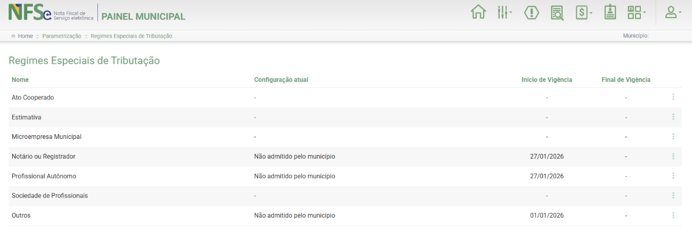
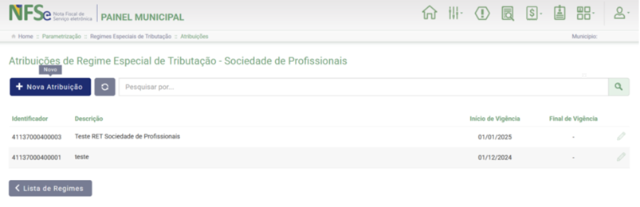

# 2.1.4 Configurar os Regimes Especiais de Tributação

Para emitir notas e gerar apurações utilizando Regimes Especiais de Tributação, para determinados serviços ou contribuintes, é necessário antes configurar as atribuições e os tipos de regime “Ato Cooperado”, “Estimativa”, “Microempresa Municipal”, “Notário ou Registrador”, “Profissional Autônomo”, “Sociedade de Profissionais” e “Outros”, através do Painel Municipal.

Abrir o menu “Parametrização” e clicar em “Regimes Especiais de Tributação”. Clicar no menu à direita de cada tipo de regime, com 3 (três) pontos na vertical (⋮) e escolher “Configurar” para regimes ainda não configurados, ou ainda “Alterar Configuração” ou “Lista de Atribuições” para regimes já configurados anteriormente. Dentro de cada tipo de regime, preencher os campos obrigatórios:

- Configuração (“Não admitido pelo município”, “Informado na DPS pelo Emitente - Sem verificação” ou “Atribuído para contribuinte(s) específico(s)”);
- Início da vigência;
- Legislação;

<!-- p.13 -->Caso seja escolhida a configuração “Atribuído para contribuinte(s) específico(s)”, é necessário preencher ainda pelo menos 1(um) contribuinte, e opcionalmente, os serviços vinculados a este regime especial.

Ainda nesta opção de configuração, é possível vincular determinados serviços a determinados contribuintes ou grupo de contribuintes separadamente. Para isto, após finalizar a configuração inicial, vinculando o primeiro contribuinte, ou lista de contribuintes obrigatória, clicar em “Lista de Atribuições” e clicar em “Nova Atribuição”.

Será aberta novamente a tela de configuração para que sejam preenchidos os dados referentes aos demais serviços e contribuintes a serem vinculados. Estas configurações podem ser efetuadas em grupo, por exemplo, selecionando diversos contribuintes e diversos serviços simultaneamente. Para cada serviço ou grupo de serviços adicionado é necessário também informar o “Início de vigência” e a “Legislação”.

<!-- p.14 -->No exemplo de “Emissão de NFS-e com Regime Especial de Tributação”, será utilizado o serviço “01.06.01.000 - Assessoria e consultoria em informática”, para o tipo de regime de tributação especial “Sociedade de Profissionais”. Incluir este serviço e, ao final, clicar em “Confirmar” para salvar as alterações.
