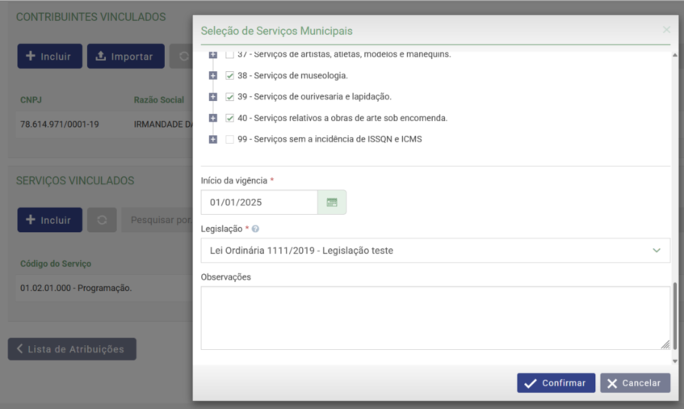

# 2.1.5 Configurar os Benefícios Municipais para o MAN

Para que apurações no MAN possam utilizar benefícios municipais de redução de base de cálculo percentual (%) ou monetário (R$) no cálculo do ISSQN, para determinados serviços ou responsáveis tributários, é necessário antes configurar os Benefícios Municipais no Painel Municipal.

Abrir o menu “Parametrização” e clicar em “Benefícios Municipais”. Clicar em “Novo Benefício”, e preencher os campos obrigatórios:

- Descrição;
- Legislação;
- Início da vigência;
- Tipo de Benefício para apuração do ISSQN (MAN);
- Redução da Base de Cálculo MAN;
- Tipo de Redução da BC (Redução por valor percentual ou monetário);
- Serviços vinculados (opcional);
- Contribuintes beneficiários vinculados ao serviço, CPF ou CNPJ (opcional);

<!-- p.15 -->Para cada serviço ou grupo de serviços, e contribuintes ou grupo de contribuintes beneficiários vinculados, a serem incluídos para a opção de utilização do benefício municipal, é necessário informar também obrigatoriamente o “Início de vigência” e a “Legislação” referente. Ao final, clicar em “Confirmar” para salvar as alterações.
