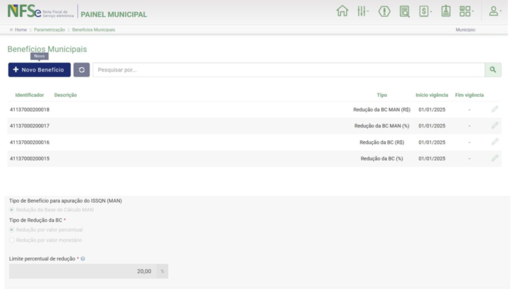
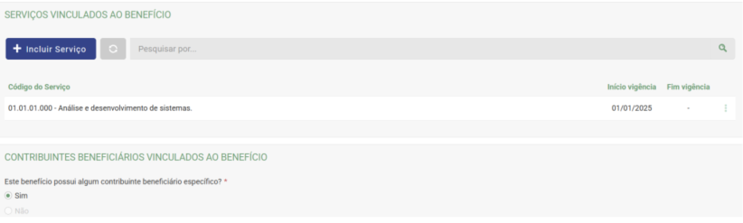
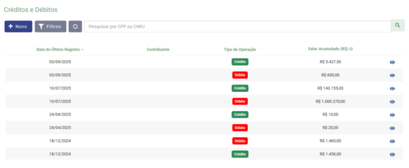
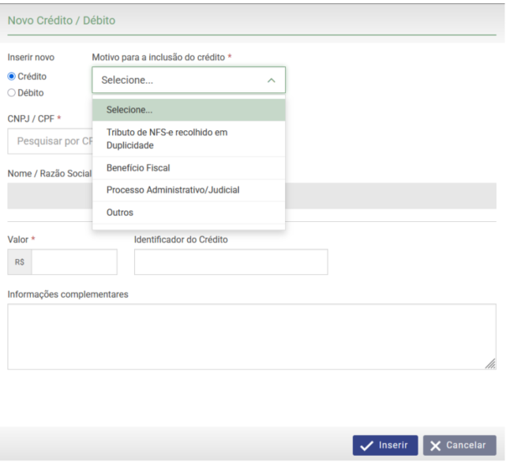
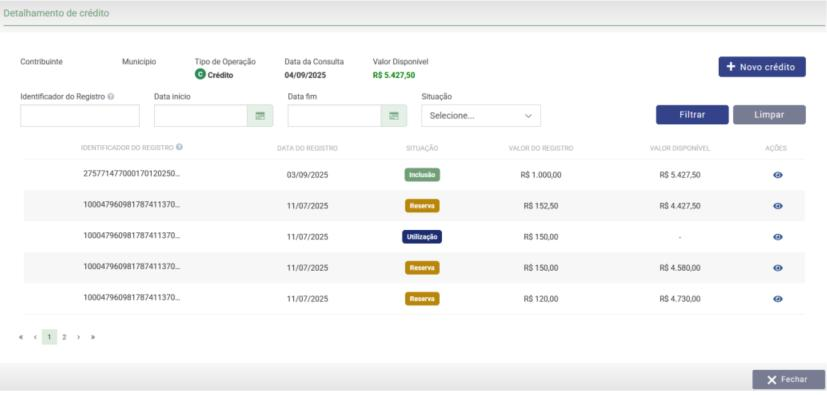

# 2.1.6 Inclusão de Créditos

É possível incluir créditos vinculados a determinados contribuintes do convênio através do painel de créditos e débitos. Os créditos incluídos são disponibilizados durante as pré-apurações, na forma de descontos que podem ser aplicados nas apurações do MAN.

Abrir o menu “Apuração Nacional” e clicar em “Créditos/Débitos”, clicar em “Novo”.

<!-- p.16 -->Será aberta a tela de “Novo Crédito / Débito”. Escolher “Crédito” e preencher os campos obrigatórios:

- Motivo para a inclusão do crédito (“Tributo de NFS-e recolhido em Duplicidade”, “Benefício Fiscal”, “Processo Administrativo/Judicial”, “Outros”);
- CNPJ / CPF;
- Valor;
- Identificador do Crédito (opcional);
- Informações complementares (opcional);

O valor total de créditos disponíveis para utilização por cada contribuinte aparece na coluna “Valor Acumulado (R$)” da lista inicial exibida no painel de créditos e débitos. Para consultar e detalhar os créditos acumulados existentes, clicar na ação “Visualizar Detalhes” na listagem, no ícone azul (👁) à direita da coluna “Valor Acumulado (R$)”. Será mostrada a tela a seguir:

<!-- p.17 -->Os créditos podem ser filtrados pelo “Identificador do Registro”, “Data Início”, “Data Fim”, e “Situação”, que por sua vez pode ser “Inclusão”, “Exclusão”, “Reserva” e “Utilização”, os quais informam se o crédito ainda está disponível para ser utilizado ou se houve alguma outra operação que tenha subtraído o valor do total acumulado. Para visualizar os detalhes da operação, clicar na ação “Visualizar Detalhes” na listagem, no ícone azul (👁) na coluna “Ações”.

