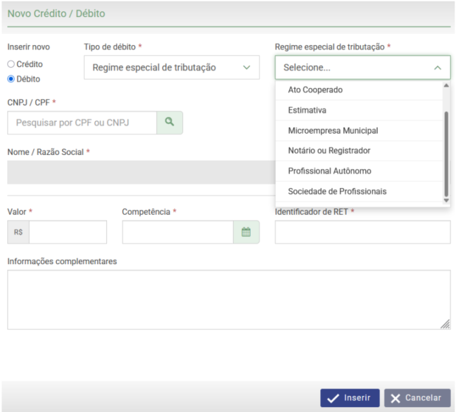
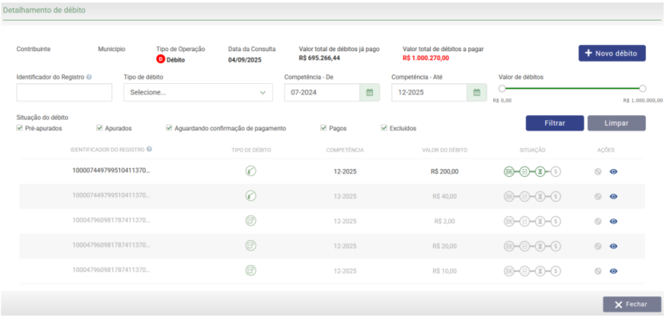

# 2.1.7 Inclusão de Débitos

É possível incluir débitos vinculados a determinados contribuintes do convênio, através do painel de créditos e débitos. Os débitos incluídos para o contribuinte podem ser do tipo “Auto de Infração”, “Outros débitos” ou “Regime Especial de Tributação”, e são disponibilizados na forma de novas pré-apurações no MAN, referentes à data de competência informada durante a inclusão.

Abrir o menu “Apuração Nacional” e clicar em “Créditos/Débitos”, clicar em “Novo”.

Será aberta a tela de “Novo Crédito / Débito”. Escolher “Débito” e preencher os campos obrigatórios:

- Tipo do débito (“Auto de Infração”, “Outros débitos” ou “Regime Especial de Tributação”);
- Regime especial de tributação (se for o caso);
- CNPJ / CPF;
- Valor;
- Competência (mm-yyyy);
- Identificador de Auto de Infração, Identificador de Outros Débitos ou Identificador de RET, a depender do tipo do débito;
- Informações complementares (opcional)

<!-- p.18 -->Caso o tipo do débito selecionado seja “Regime Especial de Tributação”, é necessário também preencher o tipo de regime especial de tributação, dentre as opções: “Ato Cooperado”, “Estimativa”, “Microempresa Municipal”, “Notário ou Registrador”, “Profissional Autônomo”, “Sociedade de Profissionais” e “Outros”.

Os débitos referentes à regime especial de tributação serão automaticamente vinculados a pré-apurações de NFS-e emitidas com o mesmo tipo de regime especial e que estejam agrupadas na mesma competência.

Os débitos referentes à “Auto de Infração” ou “Outros Débitos” gerarão uma nova pré-apuração com data na competência informada.

Para consultar e detalhar os débitos acumulados existentes, clicar na ação “Visualizar Detalhes” na listagem, no ícone azul (👁) na coluna “Ações”. Será mostrada a tela a seguir:

<!-- p.19 -->Os débitos podem ser filtrados pelo “Identificador do Registro”, “Tipo de débito”, “Competência - De”, “Competência - Até”, e “Valor”. Para visualizar os detalhes de cada débito, clicar na ação “Visualizar Detalhes” na listagem, no ícone azul (👁) à direita da coluna “Situação”.

Os débitos que ainda estiverem na situação “Pré-Apurado” podem ser cancelados, através da operação “Cancelar Débito”, utilizando o ícone azul redondo também na coluna “Ações”.

Ao cancelar um débito será apresentada a tela a seguir, onde deverá ser preenchido o campo obrigatório “Motivo para o cancelamento do débito”. Ao final, clicar em “Excluir” para cancelar o débito.
