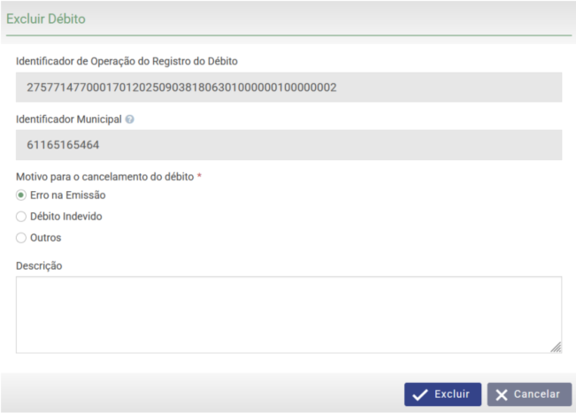

# 2.2.1 Acessar o Emissor Nacional NFS-e

Nos tópicos a seguir, serão demonstrados exemplos de utilização do MAN dentro do Emissor Nacional.

Fazer login no Emissor Nacional em:

https://www.nfse.gov.br/EmissorNacional/Login?ReturnUrl=%2fEmissorNacional

Preencher CPF e senha do contribuinte, responsável tributário que irá realizar as apurações no MAN e gerar as guias de arrecadação.

